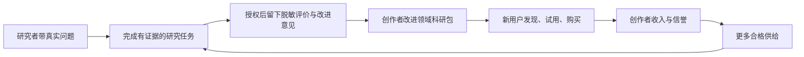
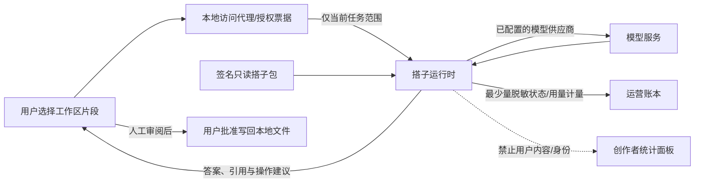

# Lattice 商业化战略 1.0.0

## 格子，你的科研搭子

> 文档版本：1.5.0｜业余时间经营主线与阶段闸门收敛：2026-10-21（北京时间）  
> 文档性质：商业产品前瞻规划与执行基线，供创始人、产品、设计、研发和运营共同使用。  
> 当前状态：本版把战略收敛为适配全职工作的单创始人验证路径；市场、价格、付费和生态数据均未验证。90 天内不把正式收费或创作者市场设为必达目标。  
> 版本边界：“商业化 1.0.0”表示首套完整商业体验，不是软件版本。2026-10-21 工作区 `package.json` 为 3.1.2；当日交付记录仍描述 3.1.1 修正候选且标记待验收，不能证明当前 3.1.2 构建已通过或正式发布。任何试用都要固定实际构建并重新核验。

---

## 阅读导航

- 创始人：先读第 36 节单人经营控制页，再读第 1、20 节；每周只执行一条主线。
- 产品/研发：读第 2、6—8、20、36 节，先映射现有能力，不默认新增功能。
- 推广/销售：读第 15、27、28、33、36 节；前 90 天只跑一个获客渠道。
- 生态/团队：第 26、29—35 节是主产品过门后的条件路线，不属首发并行待办。

**经营落地优先读法：**若只执行一件事，按第 36 节用单篇论文共读验证价值。第 15、27、28 节的内容/收费方案均受第 36 节兼职工时和“不收款”规则约束；前 90 天只用现有研究关系触达一个 cohort。第 26、30—35 节是主产品门槛之后的条件路线。

全文使用四种明确口径：**事实**来自仓库或已核对官方资料；**决策建议**是本战略推荐的默认方案；**验证假设**必须通过用户与经营数据检验；**未来方向**不进入首发销售承诺。文中数量门槛、价格与预算除另有说明，均为内部实验设计，不是行业基准、市场调查结论或收入预测。

## 本版时间线总览

**计划基准日：2026-10-21；首个阶段判断日：2027-01-19。**这是按每周最多约 8 小时制定的建议计划，不是商业上线日期。前两周记录实际可用时数；如果长期低于 6 小时/周，就保持单人问题验证、按实际工时顺延，不挤占睡眠或全职工作。

| 阶段 | 日期 | 唯一阶段目标 | 可验收交付物 | 晋级条件 |
| --- | --- | --- | --- | --- |
| 1. 复位与基线 | 10/21—11/03 | 确认可用业余时数，并盘清当前候选 | 两周工时记录；3 次用户访谈；一页产品事实表 | 确认每周容量至少 6 小时；否则缩为用户访谈，不排功能开发 |
| 2. 问题验证 | 11/04—11/24 | 判断一个具体论文阅读问题是否重复发生 | 累计 6—8 次访谈；3 次共读任务观察 | 至少 4 人展示相似卡点、替代流程和失败成本；否则改客群/问题 |
| 3. 现有能力走查 | 11/25—12/15 | 判断现有代码是否已经支持单篇论文闭环 | 5 名目标用户走查；代码/产品差距表；最多 3 个阻断项 | 3/5 完成来源核对和笔记保存；不得预设需要新增模块 |
| 4. 小样本复访 | 12/16—2027/01/12 | 判断用户是否愿意隔日继续研究 | 邀请 5—8 人；记录任务、求助、工时与复访 | 只报告已成熟样本的 D7/W4；不足则明确记“未验证” |
| 5. 阶段决策 | 2027/01/13—01/19 | 决定继续验证、准备收费 Beta 或调整方向 | 一页证据、现金预算、风险和决策记录 | 收款、许可、安全、支持任一未就绪，不启动收费 |
| 主线配套共读 | 90 天内最多每月 1 场 | 作为访谈/任务观察方式，不做第二个增长项目 | 一场活动复盘和用户任务结果 | 挤占 8 小时周容量就取消或顺延 |
| 创作者 E1/E2 | 90 天后另立项目 | 先证实双边需求，再决定是否做平台 | 创作者/购买者研究与独立开发计划 | 不属于首发日期或当前兼职主线 |

### 执行状态词

- **未启动：**没有负责人/资源/日期确认；不能算延期或完成。
- **进行中：**负责人已接下任务，有明确截止和每周可见产物。
- **通过：**交付物和晋级条件都有原始证据，负责人记录证据位置。
- **延期：**说明缺失条件、用户影响、下一检查日；不降低质量门槛。
- **停止/转向：**触发停止条件，保存结果并决定资源转投方向。

每周更新这五个状态。测试数、用户满意度原话、线上分钟数和功能开发完成度不能单独替代阶段目标。

### 全职工作下的每周 8 小时执行合同

| 工作块 | 上限 | 一周动作 | 交付 |
| --- | ---: | --- | --- |
| 产品/研发 | 3h | 只走查或修一个最高优先级 P0 阻断；没有阻断时不造新功能 | 一个可复测差距项，或“当前能力足够”的证据 |
| 用户研究 | 2h | 一次 30—45 分钟访谈/观察 + 记录；测试者不够时做招募 | 一份匿名任务记录 |
| 试用支持 | 1h | 集中回复一次；只处理影响主任务的问题 | 问题日志和优先级 |
| 经营决策 | 1h | 更新样本数、任务成功、复访、成本、预算和下一决定 | 一页周报 |
| 缓冲 | 1h | 全职工作或家庭突发；未使用则休息 | 不提前填任务 |

连续两周实际投入超过 8 小时，下一周必须删减任务或顺延，不补债。每两周最多一项公开内容；共读活动替代当周用户研究块，不加班承办。若可用时间低于 6 小时/周，切换为“纯问题验证模式”，暂停代码开发与推广。

阶段指标均为方向信号而非统计证明。前 90 天可用 6—8 次访谈、5 次任务走查和 5—8 位邀请测试者来发现明显问题；不要求 30/100 样本、不设必须的 D7/W4 百分比、不收款。样本少就报告 `人数/样本数`、典型失败和是否成熟；未成熟统一记“未验证”。

### 决策权与人力替代规则

- 创始人是每个阶段的唯一 accountable owner，并对是否启动、预算、产品范围和对外承诺负责。
- 研发代码由创始人或其明确指定的当前实现者完成。没有指定实现者时，产品访谈、资料准备和现有代码路径映射可以继续；新产品功能任务标为未启动。
- 外部领域/安全/法务顾问只承担明确定价、有期限、有交付物的评审，不默认成为持续运营人力。
- 产品增长负责人只在 5 次主任务观察后，若用户招募/跟进持续挤占超过每周 2 小时并导致验证停摆时，做 4 周有薪项目试用；试用交付为 5 次目标用户观察、一个清楚漏斗、一个可证明的 P0 改进。没有现金预算就不启动招聘。
- 搭子市场、第二渠道和商业 SaaS 只能在创始人明确重新批准时间/现金预算后另开项目；前 90 天禁止并行。

## 1. CEO 决策摘要

### 1.1 这家公司首先交付什么

Lattice 首先服务成年理工科研究生、青年研究者与研究型学习者，围绕真实论文提供可追溯、可编辑、可继续的共同研究体验。用户购买的是更顺畅地理解材料、检验想法、积累成果的过程，以及由此产生的安心与连续感。

**首发品牌：格子，你的科研搭子。**

**首发价值主张：陪你读懂论文，一起推敲，把想法留下来。**

**首发标志性体验：打开一篇论文，与格子读懂一个难点，核对出处，审阅并保存批注与研究笔记，下次回来继续。**

“搭子”的情绪价值通过耐心、理解上下文、记得项目进度、允许安静和尊重判断实现；专业性通过证据、正确操作、明确不确定性和可靠保存实现。两者共同构成产品标准。

### 1.2 八项战略选择

| 决策 | 推荐方案 | 理由与约束 |
| --- | --- | --- |
| 第一用户 | 创始人可直接邀请到、近期正在读具体论文的成年研究者 | 先验证真实任务，不从宏观客群推导功能 |
| 第一任务 | 单篇论文深读到一份有证据的研究笔记 | 容易展示、体验、验收和复用 |
| 第一平台 | 已有 Windows 桌面端为完整体验主阵地，Web 为介绍、演示与限定体验 | 不同步承诺所有平台、浏览器和本机能力 |
| 第一品牌 | 格子承载人格，Lattice 格致承载研究空间 | 统一传播，同时保留成熟的软件身份 |
| 第一收入 | 只验证官方托管 AI 固定额度；本地开源核心免费 | BYOK/本地模型不收 Lattice 订阅费；前 90 天不收款 |
| 第一增长 | 现有研究关系的一对一定向邀请 | 先看到任务闭环和跨日复访，再考虑做内容/第二渠道 |
| 第一护城河 | 高质量科研操作、长期成果关系、可信人格与任务评估 | 让差异化落实到共同做事的全过程 |
| 第一扩展 | 科研深耕后进入相邻的成年专业学习 | 旅行、情绪支持、健康生活暂不进入首发 |

### 1.3 三个阶段的经营目标

1. **证明有用**：用户在自己的论文上独立完成核心任务，并在不同日期主动回来。
2. **证明可卖**：用户支付真实费用，清楚知道买到什么，使用成本与支持成本可承担。
3. **证明可复制**：新增用户不主要依赖创始人一对一带教，多个渠道能带来同样质量的用户。

阶段推进由证据决定。不能用安装包发布、测试数量、粉丝数、访谈中的赞美或预订名单代替这三个目标。

### 1.4 CEO 需要坚持的资源纪律

- 每个迭代周期最多推进一条核心用户流程和一条可靠性工作线。
- 兼职 8 小时周按可用时间分配：产品/走查 3h、用户观察 2h、支持 1h、经营记录 1h、突发缓冲 1h；详见第 36 节。
- 未来模式、复杂插件市场、完整 IDE、自研基础模型、重型多人协作不分配首发关键路径资源。
- 已有功能的历史投入不构成继续主推的充分理由；以首发任务的必要性排序。
- 不为大客户承诺尚未具备的服务等级，不用无限 AI 或终身服务提前透支现金。

## 2. 现有资产、成熟度与事实边界

### 2.1 已有产品资产

依据仓库说明与交付记录，Lattice 已有 PDF 阅读与批注、论文关联笔记和子文件、Markdown、代码及 Notebook、本地执行、证据引用与 AI 草稿审阅、插件、皮肤、共享库、多格式预览及桌面/Web 发布能力。这意味着商业化应优先组织现有资产、收敛体验，而不是重新建设全套系统。

**共享库事实边界：**现有共享库已有 [10 月 13 日部署记录](../tests/2026-10-13-cloud-production-deployment.md)和[10 月 17 日生产升级/合成验收](../tests/2026-10-17-cloud-large-production-acceptance.md)，覆盖 RLS、私有对象存储、成员权限与 20 MiB 文件处理；这证明特定链路曾通过部署验收，不代表个人多设备同步、全项目灾备、定时备份、通知、独立恢复或付费 SLA 已就绪。生产验收记录明确列出这些尚未完成的运维能力。共享协作功能与个人同步、备份恢复必须分别命名、披露和验收。

| 资产 | 商业价值 | 首发处理 |
| --- | --- | --- |
| PDF 文本选择、批注和定位 | 核心信任基础 | 首发必需，复杂材料持续评估 |
| 论文关联笔记、内部链接、重开恢复 | 让阅读留下可积累成果 | 首发必需，降低内部结构暴露 |
| AI 读取、证据解析、草稿审阅与写回 | 共同做事的基础 | 收敛为用户可理解的少数操作 |
| Markdown 与数学内容 | 研究笔记表达 | 保留，减少编辑模式选择负担 |
| 代码、Notebook、本机运行器 | 长期的研究验证优势 | 首发保留为高级能力，不作为首次任务依赖 |
| Word、PPT、图片、HTML、手写 | 资料兼容与研究扩展 | 保留基础入口，按实际质量标注边界 |
| 插件与多套皮肤 | 共创与个性表达 | 先提供精选默认值，高级管理后置 |
| 已部署共享库 | 可支持受控成员共享与权限验证 | 已有生产/合成验收记录；仅按真实支持范围受控使用，不等于个人同步、备份服务或 SLA |

### 2.2 不能直接转换为销售承诺的内容

- 最新剩余开发记录仍区分源码实现、定向验证、统一门禁、安装交付与生产运行，不能合并成“全部完成”。
- AI 曾有真实成功与空正文失败记录；本战略不以离线回归证明当前模型在真实科研任务上的质量。
- 公式 OCR 有实际本地运行与合成样本结果，也保留字符和矩阵误识别；不能宣传任意公式准确识别。
- 云运维代码存在，不代表持续监控、通知、异地备份和独立恢复已经运行。
- 大目录短时合成性能、自动化拖放不代表任意资料库与所有系统操作均已验证。
- 仓库未提供足以支持本战略的真实用户留存、付费转化、渠道成本与续费数据。

能力基线按 2026-10-21 工作区与交付记录校对。当前 `package.json` 是 3.1.2；[该日期的交付记录](../tests/2026-10-21-final-delivery.md) 仍写 3.1.1 修正候选待验收，不能替代对 3.1.2 可执行构建的测试。仓库有并行未提交变更，战略文件不把版本号或 changelog 条目当成冻结发行证据。每次真实试用前必须固定构建哈希并核对安装、能力和限制。

### 2.3 内部证据入口

- [现有产品策略](../../PRODUCT_STRATEGY.md)：技术产品方向背景；部分日期、域名和版本已陈旧，不作为当前发行事实。
- [README](../../README.md)：能力和项目入口。
- [3.1.1 修正候选验收记录](../tests/2026-10-21-final-delivery.md)：记录仍待验收，不能证明当前 3.1.2 构建已通过。
- [当前 3.1.0 交付基线](../tests/2026-10-20-final-delivery.md)：仅作为此前已验收版本的事实，不证明当前修正候选通过。
- [剩余开发边界记录](../tests/2026-10-19-remaining-closeout-delivery.md)：仅提供对应日期实现/验收边界，不替代最新候选验收。

## 3. 市场进入逻辑与竞争策略

### 3.1 从一个具体问题进入

**核心问题假设：**研究者在阅读、提问、核对、记笔记之间反复搬运材料；通用聊天很难持续理解正在看的内容，结果与原文、批注、个人想法容易分离。

**需求表达：**“我需要把这篇与我的课题有关的论文真正弄懂，并留下以后还能核对和继续使用的成果。”

验证时请用户展示最近一次实际阅读过程，识别重复操作、遗失内容、错误判断和重新寻找资料的成本。不能先解释格子的全部功能，再询问用户是否喜欢。

### 3.2 竞争对象是用户现有工作方式

| 选择 | 已有优势 | Lattice 的竞争重点 | 行动 |
| --- | --- | --- | --- |
| Zotero | 文献收集、引文与资料组织 | 论文理解到研究笔记的连续体验 | 支持用户保留原文献管理方式；导入能力按真实状态表述 |
| Obsidian | 本地知识积累与扩展 | 证据定位、共读操作与论文关联成果 | Markdown 可带走，减少迁移顾虑 |
| NotebookLM 等资料 AI | 资料理解、来源辅助、学习和研究输出 | 用户本地材料上的操作连续性和可审阅写入 | 用同任务对照评估，承认对方已具备的能力 |
| Elicit 等研究产品 | 文献研究与结构化工作流 | 深读当前材料、项目连续性及共同操作 | 不首发承诺系统综述平台的完整能力 |
| 通用 AI 聊天加文件夹 | 已有习惯、选择多 | 少搬运、少丢上下文、直接留下成果 | 证明任务时间、结果可用性或体验的实际改善 |

官方资料显示，Obsidian 核心应用免费、通过可选服务收费；Zotero 采用存储订阅支持服务；Elicit 同时提供免费与付费研究功能。这些事实表明用户已有替代选择，不证明 Lattice 的付费率或市场规模。[来源 S1](https://obsidian.md/pricing)、[S2](https://www.zotero.org/storage)、[S3](https://elicit.com/pricing)

### 3.3 防御与发展方向

可持续优势来自四部分：科研材料上的可靠操作；围绕个人项目积累的成果关系；跨模型仍稳定的格子交互；经用户许可持续改善的领域任务评估。

“支持更多模型”“增加人格提示词”“增加按钮”都容易复制。数据可导出、信任可持续、成果能继续使用，才更有可能产生健康的长期留存。

### 3.4 不编造宏观市场

首阶段不以“全国学生人数乘订阅价格”作为可得市场。先记录能实际触达的研究群体、愿意参加访谈的人、愿意用自己资料完成任务的人和实际支付者。形成按渠道去重的底层名单与转化记录，再估算相邻市场。

## 4. 目标用户、任务与产品定位

### 4.1 首发用户画像

| 用户 | 可观察特征 | 核心任务 | 优先级 |
| --- | --- | --- | --- |
| 理工科研究生 | 成年；每周需阅读多篇论文；有正在推进的课题 | 弄懂方法、公式和实验条件，准备组会与笔记 | 第一优先 |
| 青年研究者 | 研究方向较明确；需要比较证据和重用成果 | 快速定位关键材料，检验解释，积累项目知识 | 第一优先 |
| 高年级本科与专业自学者 | 成年；有具体课程或研究项目 | 从论文中学习概念和方法 | 相邻观察群 |
| 人文社科及专业综述用户 | 文献结构、引用与审查需求可能不同 | 长文本解释、资料比较、系统整理 | 后续专门研究 |
| 课题组负责人 | 有采购权；关心共享、管理与支持 | 组织共同研究与资料交接 | 首发访谈，延后正式销售 |

画像特征是招募筛选条件，频率与需求强度仍需访谈确认。首 90 天优先在创始人可触达的一个研究群体里深入观察；能低成本触达时再纳入一个相邻方向，不设置跨学科配额。确认同一问题后，再扩方向验证适用边界。

### 4.2 三个首发任务

1. **理解难点**：选中段落、公式附近文字或明确页码，要求解释，并能回到出处。
2. **共同批注**：按当前研究目标提出少量有理由的批注，用户审阅后落到实际 PDF 条目。
3. **形成成果**：把本次讨论、已确认批注与未解决问题整理成可编辑笔记，重开后继续。

首发批注重点是“当前选区或明确章节”的少量草稿。整篇论文无人审阅批量批注、跨大资料库自主研究、自动执行任意代码均不属于必需交付。

### 4.3 定位声明

面向需要认真阅读和思考的研究者，Lattice 是一个本地优先的研究空间。格子是其中的 AI 科研搭子，与你一起理解论文、核对证据、整理批注与笔记，让每次阅读都能接着上一次继续。

### 4.4 用户获得的四层价值

| 层次 | 承诺 | 可观察证明 |
| --- | --- | --- |
| 功能 | 看、问、核对、保存衔接顺畅 | 用户独立完成核心任务 |
| 认知 | 解释有层次，能够检验理解 | 用户能复述、指出关键依据或提出更具体的问题 |
| 情绪 | 允许不会、耐心讨论、尊重节奏 | 用户反馈敢于追问，未被打断或敷衍 |
| 长期 | 成果与上下文可以延续 | 另一日期重开并使用之前成果 |

## 5. 品牌体系与“格子”人格

### 5.1 名称与层级

| 层级 | 标准用法 | 使用场景 |
| --- | --- | --- |
| 产品 | Lattice 格致 | 安装包、设置、条款、产品官网身份 |
| AI 伙伴 | 格子 | 对话、共读、引导、品牌内容 |
| 首发定位 | 格子，你的科研搭子 | 首页、首发视频、宣传卡片 |
| 解释句 | 陪你读懂论文，一起推敲，把想法留下来 | 价值说明和产品演示 |
| 长期愿景 | 格子，你的百变搭子 | 内部愿景与阶段性品牌探索，首发不占据主页面 |

首次出现建议写“Lattice 格致，与格子一起做研究”，之后自然使用格子。避免在一个首屏同时出现科研操作系统、全能 Agent、超级 IDE、知识大脑等多个身份。

“格子”名称的商标、同名产品、域名与账号可用性尚未核验。正式投入传播与视觉制作前，由品牌负责人完成检索与专业核验，形成采用、组合名或替代名决策；本文件不表示已取得任何名称权利。

### 5.2 品牌使命、愿景与价值观

- **使命**：让认真思考的人更容易理解、检验和积累自己的研究。
- **阶段愿景**：成为研究者愿意反复打开、敢于深入讨论的科研搭子。
- **长期愿景**：在不同场景中，与人共同理解世界、完成有意义的事情。
- **价值观**：诚实有据；好奇而有判断；温和且直接；尊重个人节奏；成果属于用户。

### 5.3 人格行为规范

| 特征 | 应表现的行为 | 避免的行为 |
| --- | --- | --- |
| 耐心 | 允许重复追问，换一种解释方式 | 羞辱、敷衍、催促升级 |
| 专业 | 区分论文事实、解释与推测，保留来源 | 无依据地肯定，伪造已读或已完成 |
| 有判断 | 提出可检查的反例和问题 | 无条件赞同、堆砌奉承 |
| 自然 | 语言具体，顺着当前任务推进 | 固定套话、每条都喊昵称和夸奖 |
| 克制 | 允许静默，主动建议可以关闭 | 频繁弹窗、打断阅读、制造离开负担 |
| 连续 | 说明记住了什么，允许用户纠正 | 假装了解未保存的历史，推断私人情绪 |

### 5.4 情绪价值的产品定义

科研搭子的情绪价值，主要来自“我可以不懂”“我的想法被认真对待”“进展不会丢”“我能掌控节奏”。首发采用共同任务中的支持，不设计排他依恋、虚拟亲密关系或强制签到。

格子应始终可识别为 AI。用户说停止、关闭、先不聊时立即尊重；不会通过“我会难过”“你怎么又不来”等话术挽留。使用时长不是北极星指标。

### 5.5 视觉与声音方向

- 视觉关键词：安静、精确、温暖、轻巧、可辨认。
- 保留既有图标体系与主题资产，先完成统一标志、字标、强调色、层级和状态表达，再考虑新吉祥物。
- 格子形象应在 24px 图标与小尺寸头像下仍清楚；表达专注、思考、完成、等待四类状态，避免用无限动画干扰阅读。
- 默认提供一套明确的浅色和深色外观；多套皮肤进入设置，不作为首发选型任务。
- 文献正文始终有最高阅读优先级；格子头像、动效和消息面板不遮挡原文或选区。
- 语音作为后续验证项；先让文字交互和真实翻页可靠，再投入持续语音、打断和音色体验。

交付物：一页品牌规范、标志和头像文件、色彩与字体规则、状态示例、十条人格正例和十条反例、官网与应用统一文案表。现有视觉截图仅作参考，不作为本规范已实现的证明。

## 6. 首发范围：主推、保留、延后

### 6.1 功能进入首发的四问

功能至少满足以下一项，并且不会破坏核心稳定性：直接帮助三个首发任务；保护成果与隐私；降低首次成功门槛；完成真实收费与服务交付。仅能增加演示热闹程度的功能不进入关键路径。

### 6.2 全量能力取舍表

| 能力 | 商业 1.0.0 安排 | 首发用户入口 | 后续进入条件 |
| --- | --- | --- | --- |
| PDF 打开、拖入、阅读、页码与大纲 | P0 主推 | 主入口 | 首发核心材料语料验证 |
| 选区解释、当前页与明确页码提问 | P0 主推 | 选区菜单与格子面板 | 来源范围清楚、失败可恢复 |
| 格子翻页、跳页、跳到已核验出处 | P0 主推，文字命令即可 | 对话和阅读器 | 工具结果经过实际阅读器确认 |
| 手动批注、编辑、删除、保存恢复 | P0 主推 | 阅读器 | 数据安全、撤销与重开验证 |
| AI 少量批注草稿、逐条审阅写入 | P0 主推 | “一起做批注” | 锚点正确，拒绝模糊定位，支持拒绝 |
| 研究笔记生成、编辑、来源链接、导出 | P0 主推 | “整理本次阅读” | 真实文件落盘、可读可改可核对 |
| 项目进度与阅读位置恢复 | P0 主推 | 重开后“继续上次” | 以已保存记录为依据，用户可清除 |
| 小范围多论文比较 | P1，首发不依赖 | 完成单篇后逐步开放 | 先通过两到三篇的真实任务质量评估 |
| Markdown 数学与基础编辑 | P0 基础 | 笔记中自然出现 | 特殊排版可靠，不要求学习编辑器体系 |
| Notebook、代码运行、解释器 | 保留为高级研究工具 | “更多研究工具” | 独立环境说明和安全运行，后续验证场景留存 |
| VS Code 集成、终端、调试和 SCM | 保留但不主推 | 高级设置或工具菜单 | 确认对核心研究用户有增量价值 |
| MCP、本地 CLI、多个供应商与模型参数 | 保留为高级接入 | 模型高级设置 | 默认路径无需理解上述概念 |
| Word、PPT、图片、HTML 预览 | 保留兼容能力 | 打开对应文件时出现 | 按格式实际质量承诺，不进入广告功能堆列 |
| 手写、画布、图片编辑 | 保留原功能，首发弱化 | 更多工具 | 有独立研究任务与使用数据支持 |
| 扫描 PDF、复杂公式 OCR | 实验功能，首发不作通用保证 | 明示支持范围的实验入口 | 授权语料评测、质量阈值与安装体验通过 |
| 多套皮肤、主题 JSON 编辑 | 保留，默认简洁 | 外观高级设置 | 不阻塞首次任务 |
| 插件安装、SDK、开发者市场 | 原能力保留，市场延后 | 高级插件管理 | API 稳定、精选质量及支持成本可控 |
| 共享库、小组权限、云端协作 | 受控试点，不进入默认起步流程 | 显式加入邀请 | 独立备份恢复、计费容量和支持就绪 |
| 浏览网页、网页资料索引 | 保留辅助 | 明确打开网址时 | 来源质量、导航状态与安全边界验证 |
| 大规模自主 Agent、自动改写资料库 | 延后 | 不进入首发宣传 | 权限、预览、回滚与结果质量成熟 |
| 课程体系、旅行、情绪支持、健康生活 | 后续产品线 | 不在首发出现模式大厅 | 按第 23 节独立验证 |

P0 表示首发承诺必需，P1 表示首发后的优先候选，并不表示当前代码缺失。表中的产品包装是建议，尚未在本次工作中修改软件入口。

### 6.3 功能后置的实施原则

保留用户已有文件、设置、快捷键与工作流；新用户采用简洁默认布局，既有用户可以继续使用原高级入口。将功能隐藏或移动前，确认可发现路径并更新帮助。不能通过删除用户数据、破坏旧格式或锁住既有文件来实现商业分层。

### 6.4 首发支持范围

完整商业体验首先验证 Windows x64 桌面。材料优先为可提取文字的中英文科研 PDF；首批评估覆盖双栏、数学符号、长文、不同页码标识和含图表文章。扫描件、受限 PDF、严重损坏文字层、纯图表推断明确显示限制。

暂定主宣传支持材料为单篇不超过 100 页、20 MiB 的可提取文字 PDF；这是候选发布范围，必须通过对应样本和性能验证后才能公开。20 MiB 云上传历史验收不自动证明桌面或 AI 能处理同范围全部内容。超出范围可尝试打开，但不得伪装成完整支持。

Web 能力按独立浏览器清单验收；不能把网页可打开等同于手机已具备完整桌面体验。

## 7. MVP 产品方案：一次完整的论文共读

### 7.1 MVP 定义

MVP 是一套范围有限、能够完整兑现品牌承诺的体验。用户不需要先学习文件组织、模型参数和 Agent 术语，就能与格子完成三个首发任务，并且能带走成果。

**本轮唯一主闭环：进入 → 打开论文 → 理解一个难点 → 核对出处 → 审阅批注 → 整理笔记 → 保存 → 再次回来。**

### 7.2 用户旅程与交付要求

| 阶段 | 用户动作 | 格子与产品表现 | 验收依据 |
| --- | --- | --- | --- |
| 了解 | 看首页或短视频 | 一句话说明科研搭子，展示真实过程与成果 | 用户能用自己的话复述用途 |
| 开始 | 点击“和格子读一篇论文” | 可用示例或自己的文件；示例明确标记 | 不必先连接共享库或配置高级工具 |
| 选择材料 | 拖入 PDF 或使用文件选择器 | 保留原文件，说明关联成果保存位置 | 原资料未被静默移动或覆盖 |
| 确定目标 | 输入阅读目标，或选“先弄懂一个难点” | 询问必要背景，避免长表单 | 能直接进入阅读，无强制人格测验 |
| 理解 | 选择一段文字并提问 | 结合当前范围解释，可继续追问 | 没有把当前页阅读说成整篇通读 |
| 核对 | 点来源 | 跳到正确页与可见位置，失败可重定位 | 页面实际到达，目标内容可核对 |
| 批注 | 请格子提出批注 | 建议少量内容并解释理由，先预览 | 用户接受、修改、拒绝均生效 |
| 整理 | 点击“整理本次阅读” | 使用实际已读证据和已确认内容 | 新推测与未解决问题有标记 |
| 保存 | 预览并确认写入 | 创建或更新明确目标文件 | 落盘成功；失败保留草稿与重试 |
| 再来 | 重开论文 | 显示阅读位置、已有笔记与未解决问题 | 用户可选择继续、忽略或清除记录 |

### 7.3 “帮你翻页”的产品契约

首发支持文字输入“下一页”“回到第 12 页”“打开刚才的出处”等明确操作。执行结果以阅读器实际确认状态为准，不以模型说“已翻页”为准。页码超界时说明实际范围；印刷页码与 PDF 页序不同则区分显示。快速重复操作、切换文件和异步迟到结果不得把用户带到错误文档。

不以模型推断用户读完作为自动翻页依据。连续语音与自动伴读另行验证，不因品牌需要而虚构已支持。

### 7.4 “帮你批注”的产品契约

默认针对当前选区或明确章节提出 1—3 条建议；建议数量可调整。每条包含原文片段、位置、批注内容与建议理由。用户可接受、修改或拒绝。找不到精确位置时保留为建议，明确需要手动定位，不写入虚假高亮。

确认后写入实际论文条目，支持后续编辑与删除，重开后仍存在。区分用户原笔记和 AI 新建议，不能把草稿已创建当作批注已保存。

### 7.5 “给你讲解”的产品契约

- 先理解用户要解决的具体问题，回答长度与背景程度可调。
- 对正文事实引用实际来源；对补充知识注明其角色；对推导解释承认假设与缺失步骤。
- 用户要求“像刚入门一样讲”时，可先给直觉、再补术语与公式；用户要求精确时，优先严格定义和证据。
- 图像理解未启用或图表未被实际读取时，不声称已经看懂图中的细节。
- 检索无结果时解释已查范围，提供更换关键词、指定页码或手动选区的路径。

### 7.6 “继续上次”的产品契约

首发连续性由阅读位置、论文关联笔记、本次目标与用户确认的问题清单构成。复杂长期人格记忆不是首发依赖。

界面展示“上次留在第 12 页，记录了两个待核对问题”，必须能对应真实记录。用户可以编辑或关闭项目记忆；不同工作区、账号与共享库之间不串用内容。删除对话与删除研究文件的区别必须清楚。

### 7.7 建议的研究笔记格式

1. 本次研究问题与目标论文。
2. 已确认的关键内容，每条关联出处。
3. 用户自己的理解、推测与批评。
4. 格子提供的解释，保留 AI 参与说明。
5. 尚未解决的问题与下一步核对动作。
6. 本次接受的批注链接与更新时间。

模板允许精简，不强制长篇填空。用户可以自由修改；导出不要求继续订阅才能阅读已有成果。

## 8. 首发验收体系与 AI 评估

### 8.1 三类验证必须分别成立

| 验证 | 能证明什么 | 不能替代什么 |
| --- | --- | --- |
| 确定性工程测试 | 操作、存储、状态、边界及权限行为 | 真实模型的回答质量 |
| 真实 UI 任务验收 | 用户路径、来源跳转、写入与恢复 | 不同学科研究者的持续价值 |
| 目标用户连续使用 | 有用、可理解、愿意回来与付费 | 全语料准确率和长期运营可靠性 |

邀请内测只验证用户旅程、候选代码和用户自行体验的真实模型输出；它不是商业 Beta。付费/托管 Beta 另需真实交易、服务成本、支付/退款、合规和恢复证据。本战略计划不授权新增付费模型请求；真实模型验收沿用用户自行体验边界。当前工作区标为 3.1.2，交付记录还停留在 3.1.1 修正候选，故具体试用构建仍须单独验收。

### 8.2 首发评估包

质量评估分两级，禁止将商业发布大评测压入兼职创始人的首轮市场验证：

- **90 天诊断集：**5 篇有权使用/公开论文 × 每篇 5 个任务，共 25 个任务实例；至少覆盖选区解释、出处跳转、批注审阅、笔记保存恢复和失败提示。这个样本只用于发现阻断问题，不估算全市场准确率。
- **有限收费试点评估集：**先按试点明确的 PDF 类型和任务范围扩充；至少覆盖选区解释、来源跳转、写入审阅/恢复及失败处理，并由第二位评审抽核。若样本不足，逐条报告、限制支持范围，不宣传整体准确率。
- **公开多学科商业 Beta：**只有准备向更广用户宣传通用科研支持时，才建议扩为 30 篇、多学科、100 个任务实例，并安排两位独立评审；论文授权、评审和实际工时必须提前到位。资源不足就缩小公开支持声明，不把未完成的规模评估当已验证。

评估任务包含以下六类，并记录每类样本数：

1. 选区与章节解释，含数学符号、双栏和术语歧义。
2. 明确页码、后半篇内容与来源跳转。
3. 批注建议、拒绝、修改与确认写入。
4. 讨论整理成笔记，区分事实、推测与用户意见。
5. 重开继续、文件改名、工作区切换与来源过期。
6. 无证据、模型失败、取消、超时与预算耗尽。

样本含扫描件等不支持材料时，评价正确识别限制和恢复引导，不把强行回答算作成功。合成夹具用于边界验证，与真实论文质量结果分别报告。

### 8.3 公开商业 Beta 验收门槛

以下是公开商业 Beta 的建议验收门槛，不属于 90 天兼职样本，也不自动套用到最多 5 人的受控收费试点。进入公开阶段前必须有独立评估资源、授权资料和托管预算；若没有资源，缩小可宣传的支持范围，不得用小样本声称全市场准确。

| 维度 | 口径与建议门槛 | 阻断规则 |
| --- | --- | --- |
| 数据保护 | 已定义的保存、重开、取消、改名与隔离用例全部通过 | 任一可复现数据丢失、越权或错误覆盖阻断 |
| 工具完成 | 翻页、跳转、批注、笔记各类操作至少 95% 在支持范围内完成 | 只生成口头确认不计成功 |
| 来源定位 | 诊断集核验每个已生成的引用，报告 `正确命中/测试引用`；公开多学科商业 Beta 扩充集目标 ≥95% | 任一重复性伪造引用或跨文件错绑在支持范围未解决时阻断 |
| 回答质量 | 有独立评估者的冻结任务集人工盲评平均至少 4/5，严重事实错误为 0 | 总分不能抵消关键错误；报告分布、来源、评估者和样本数 |
| 批注质量 | 每条原文、位置、语义均可核对；写回前需审阅 | 错误写入不可由满意度抵消 |
| 成本控制 | 配额、取消、失败补偿与去重账本用例通过 | 失控循环或同任务重复扣费阻断 |
| 商业交付 | 支付、开通、重装恢复、到期、退款、停服保留文件全部演练 | 不能确认权益或退款去向时阻断收费 |

Beta 的 95% 是预先设定的样本内验收目标，不是对外准确率保证。90 天样本只报告逐条结果和分母，不能外推。操作正确、引用支持结论和解释质量分开记录。

### 8.4 质量评分与延迟

每个回答按正确性、来源支撑、相关性、清晰度、共同推进价值五项评分；科研判断由具备材料理解能力的评审者参与。至少双人独立复核关键争议，记录分歧及裁决理由；团队资源不足时缩小发布范围，不取消关键复核。

暂定体验预算：本地操作可见反馈 P95 不超过 300ms；支持范围内打开首屏 P95 不超过 5 秒；AI 请求后 1 秒内显示真实状态，标准解释可读正文 P95 不超过 20 秒。记录硬件、文件、网络、模型和正文完成时间。短暂显示“思考中”不算正文；超预算要透明提示和允许取消，不能用虚假进度掩盖。

## 9. 品牌话术与产品文案库

以下为可直接用于设计稿和内部演练的候选文案；对外发布前逐条对照候选版本真实能力与适用范围。

### 9.1 官网首屏

**品牌行：**Lattice 格致  
**主标题：**格子，你的科研搭子。  
**副标题：**陪你读懂论文，一起推敲，把想法留下来。  
**说明：**在同一份论文旁提问、核对出处、整理批注与笔记。下次回来，接着研究。  
**主按钮：**和格子读一篇论文  
**次按钮：**看一次完整共读

首屏紧邻入口说明支持平台、需要的 AI 连接方式与试用成本；不能先用“立即免费体验”吸引，之后才揭示必须购买其他服务。

### 9.2 三种长度的介绍

**一句话：**格子是 Lattice 里的 AI 科研搭子，陪你理解论文、核对证据、留下研究笔记。

**30 秒：**读论文时，你可以直接问格子当前这段为什么这样。它与你一起找依据、推敲解释，提出可审阅的批注，再把本次阅读整理成自己的笔记。你始终可以回到原文核对，也能把成果带走。

**面向研究者：**Lattice 把 PDF、研究笔记和证据放在同一个工作区。格子理解当前材料与阅读目标，协助解释、定位、批注和整理；需要写入时先供你审阅。它帮助推进研究，也明确哪些内容还需要你核实。

### 9.3 应用内关键时刻

| 时刻 | 推荐文案 | 对应行为要求 |
| --- | --- | --- |
| 首次见面 | “我是格子。带来一篇你正在读的论文，我们从一个问题开始。” | 提供明确打开入口 |
| 无文件 | “打开一篇论文，或先用示例和我读一段。” | 两条路径都实际可用 |
| 不知道问什么 | “可以选一段没读懂的内容，也可以告诉我你想从这篇文章里找到什么。” | 不强迫填写完整目标 |
| 定义难懂 | “我们先确认这个符号的定义，再看它在这一步怎么用。” | 先寻找实际定义 |
| 不同意用户 | “这个解释还缺一个条件。原文在这里限定了适用范围。” | 给出具体出处 |
| 尚无证据 | “我在已读取的范围里还没找到依据，可以继续查你指定的章节。” | 明确实际读取范围 |
| 提出批注 | “我整理了三条批注建议，你可以修改后再保存。” | 默认仍为草稿 |
| 保存成功 | “已保存到这篇论文的阅读笔记，可以打开继续编辑。” | 确认真实落盘后显示 |
| 保存失败 | “这次还没保存成功，草稿已保留。你可以重试或另存。” | 草稿确实可恢复 |
| 回来继续 | “上次留在第 12 页，还有两个待核对问题。继续这里，还是先看别处？” | 仅展示真实记录 |
| 模型异常 | “这次没有收到可用回答。你的问题和草稿还在，可以重试或换连接。” | 不自动无上限重试 |
| 额度不足 | “本周期的 AI 额度已用完。笔记和阅读仍可继续，也可以查看其他接入方式。” | 不通过人格施压购买 |

### 9.4 销售与异议处理

| 问题 | 推荐回答 |
| --- | --- |
| “我已经有 Zotero。” | “你可以继续用它管理文献。先试一篇正在读的论文，看看共读、出处核对和笔记整理是否让你的过程更顺。” |
| “通用 AI 也能解释。” | “可以比较同一个任务：把解释核回原文、保存批注与笔记，再看下次能否继续。是否值得使用，由这个过程决定。” |
| “会不会胡说？” | “AI 仍可能出错。格子会显示依据、说明未确认内容，重要结论需要核对；目前支持范围也会公开说明。” |
| “论文会上传吗？” | “本地阅读与保存使用本地文件。启用云端 AI 时，相关内容会按你选择的服务发送；执行前可以查看范围与服务说明。” |
| “为什么还要付模型费用？” | “使用本地开源功能或自带模型时，Lattice 不收工作流订阅；模型费用由你选择的供应商按其规则收取。若选择格子官方托管 AI，才按页面写明的额度和价格向 Lattice 付服务费。两种费用会分开说明。” |
| “会替我完成科研吗？” | “格子协助理解、核对和整理。研究问题、关键判断和最终成果仍由你负责与决定。” |

### 9.5 禁止的营销表达

不使用未证明的“最佳科研体验”“零幻觉”“百分百准确”“完全离线 AI”“所有论文都能读”“自动发顶刊”“替代导师”“无限 AI”“永久免费云服务”。用户使用愿景式表达时，内部将其转为具体质量目标，对外仍依据证据表述。

不展示虚构用户评价、未经许可的论文或私人聊天，不把剪辑掉失败的演示称为无剪辑实录。不通过虚假名额、倒计时、焦虑和情感关系推动购买。

## 10. 首次体验与产品信息架构

### 10.1 新用户默认只需理解三个区域

论文阅读区、格子共读区、笔记与批注成果区。文件树保留但不要求理解内部 sidecar、manifest、Harness、Runner、Evidence broker 等实现术语。

主行动随阶段变化：未开始时“打开论文”，阅读时“问格子”，讨论后“整理本次阅读”，有草稿时“审阅并保存”。避免同一屏多个高亮主按钮竞争注意力。

### 10.2 首次使用顺序

1. 选择示例或自己的论文。
2. 明确 AI 接入、需要发送的资料与费用；本地阅读可直接继续。
3. 选一个问题，与格子完成一次解释和核对。
4. 保存第一条批注或一份短笔记。
5. 在用户已获得价值后，提供外观、快捷键和高级接入设置。

示例有两种清楚区分的形态：**可交互的真实 AI 试用**与**预录流程演示**。后者不能伪装成正在推理，也不计入用户激活和 AI 成功率。

### 10.3 默认格子的三种协作节奏

- **安静共读**：用户主动提问才回应，默认不打断。
- **讲清楚**：解释更细，允许分步展开与检查理解。
- **一起推敲**：讨论假设、反例与证据限制。

它们属于同一个格子的交互偏好，不是三个独立人格。首发可采用简洁文字选项；不能因增加控制项使首次使用更复杂。只记住用户选择，不静默推断心理状态。

### 10.4 官网结构

首屏价值与真实演示 → 三个研究任务 → 完整成果示例 → 来源与数据说明 → 价格与接入 → 平台和支持范围 → 常见问题与帮助。下载入口提供明确构建、版本、更新记录与校验信息，用户不必自己判断哪个发行包才是商业版本。

## 11. 数据、记忆与模型策略

### 11.1 先完善产品系统，再决定训练

先使用已有模型、上下文组织、授权资料检索和可靠工具实现核心任务。人格通过清楚的行为规范和交互范例稳定；模型选择以具体任务结果、延迟与成本评估决定。不给每个未来模式预先训练专属模型。

### 11.2 四类数据分开管理

| 数据 | 首发用途 | 管理规则 |
| --- | --- | --- |
| 用户论文、笔记与批注 | 完成用户当前研究任务 | 用户控制，按实际服务范围处理 |
| 项目与偏好记忆 | 继续研究、匹配交互节奏 | 可查看、编辑、关闭和删除；跨空间隔离 |
| 产品事件和错误摘要 | 理解漏斗、质量与失败 | 默认不含正文、文件名、绝对路径和密钥；可选分析明确告知 |
| 专门授权的示范与评估样本 | 改善质量、可能用于后续训练 | 逐项记录权利来源、用途、保留期与撤回处理 |

运行任务所需同意、产品分析同意与训练同意不能合并为一个模糊开关。供应商的数据保留和训练政策要随接入路径说明，不能承诺自己无法控制的第三方行为。

### 11.3 微调启动条件

只有在以下条件同时具备时才立项：已观察到稳定重复的行为缺口；提示词、工具或检索改进仍不足；拥有有权使用且经过质检的样本；独立评估能证明收益；费用、维护与版本回退可承担。

优先训练价值可能来自领域术语解释方式、证据使用规范、工具选择与人格一致性。实时旅行信息、最新论文和个体项目事实，仍需要相应数据连接和记忆机制，不能依靠训练权重自动保持更新。

### 11.4 模型与产品稳定性

商业首发默认推荐一个经过评估的连接路径，同时提供有限、明确的替代路径。更换模型前运行冻结任务集，检查来源、写入、成本与人格。供应商故障时保留本地阅读和草稿，不以静默切换供应商扩大资料发送范围。

## 12. 产品分析、北极星指标与验证方法

### 12.1 北极星指标

**每周完成有效研究闭环的用户数。** 有效闭环必须包含真实材料、至少一次来源核对、以及保存一份实质批注或笔记。只有聊天、打开文档、播放示例或自动创建空文件不计入。

事件仅证明用户完成动作；结果质量仍由抽样任务评估和访谈补充。不能把点击“接受”自动解释为科研正确。

### 12.2 指标口径

| 指标 | 分母与分子 | 观察要求 |
| --- | --- | --- |
| 邀请接受 | 同意参加者 / 收到定向邀请者 | 首轮不用网站曝光或社媒浏览量作分母 |
| 任务闭环 | 完成来源核对并保存成果者 / 实际开始的走查者 | 标注是否由主持人代操作；预录演示不计 |
| 首次价值时间 | 进入任务至首次有用解释并核对来源的时间 | 分开材料准备、连接配置和模型耗时 |
| W4 留存 | 激活后第 22—28 日再次完成有效研究动作的人 / 已满 28 日的激活者 | 首轮只对成熟个体记录；5—8 人样本是方向信号，不是市场留存估计 |
| 自然 W4 留存 | 同上，剔除该观察周被一对一提醒回访者 | 兼职首轮诚实记录提醒影响，不承诺固定百分比 |
| 付费转化 | 明确获得同一方案且观察满 30 日的激活者中，已支付且未全额退款者占比 | 按价格、来源、试用方案分别报告 |
| 续费率 | 到期后 14 日内续费人数 / 已到期且满 14 日的人数 | 年费不在 90 日内宣称年度续费已验证 |
| 不同日复访 | 另一日期主动再次完成研究动作的人 / 已成熟邀请试用者 | 逐人报告；样本小时只作方向信号 |
| 核心任务错误 | 错误引用、写入失败、文件丢失、越权读取次数 | 严重越权/损坏为零容忍；错误均保留可复现路径 |
| 用户表达 | “会不会带下一篇”及具体理由 | 不以聊天时长或依赖度代表产品价值 |
| 成本与支持 | 每任务变动成本、每付费用户支持分钟数 | 覆盖失败、重试和人工介入 |

### 12.3 第一轮阶段门槛

首轮兼职验证计划建立 8—10 位合格候选人的邀请池，完成 6—8 次问题访谈、最多 5 次实际走查，并让 5—8 位目标用户开始邀请试用。访谈/走查/试用尽量由同一批可触达用户承担，不将候选名单、邀请人数和重复任务计为新增用户。该样本量只用于发现明显障碍和自然复访信号，不能证明市场规模、PMF 或统计留存率。

- 发现阶段：6—8 次访谈；至少 4 人能展示同一类重复任务。未达到就重新切用户或任务；8—10 人是候选邀请池，不是访谈数量目标。
- 任务阶段：5 次用户走查；3/5 能在不由创始人代操作的前提下完成“打开—提问—来源核对—保存”，否则修复一个最高频阻断问题。
- 复访阶段：记录每位试用者的首个和第二个实际研究日期；只对已满 7/28 日者报告，逐人标记带教/提醒。
- 价格阶段：只做 5—8 次透明报价理解访谈。实际收款需要运营主体、支付、退款、隐私告知和客服均就绪；若没就绪，状态是“未测试付费”。
- 扩大阶段：不靠人数达标自动扩大；只有主任务稳定、出现自然跨日复访、每周工作量可承受后，才追加一批样本。

每项报告 `完成人数/邀请人数/成熟人数` 和失败原话。小样本中的比例只用于挑下一步，不宣传成市场结论。公开多学科商业 Beta 的评估包见 8.2；它需要额外资源，不是最多 5 人受控收费试点或本节 90 天的前置目标。

### 12.4 最小事件字典

建议事件：`research_started`、`document_opened`、`source_checked`、`annotation_draft_reviewed`、`artifact_saved`、`research_resumed`、`offer_viewed`、`payment_settled`、`refund_completed`、`task_failed`。

允许字段仅包含随机任务 ID、事件时间、客户端构建、材料类别、任务类别、结果码、耗时区间、成本与额度变更摘要、同意状态和粗粒度来源。客户端不得上传论文标题、内容、聊天文本、真实路径或密钥；少量可选诊断需单独授权。随机标识仍需按个人信息风险管理，不宣传为绝对匿名。

账户、支付和必要安全日志与可选产品分析分开管理。拒绝可选分析的用户仍可使用已购买服务；队列指标注明分析覆盖率，避免只代表同意者却外推全部用户。

### 12.5 实验纪律

每项实验先写假设、用户、操作、周期、指标和停止条件，再观察结果。样本少时用顺序访谈和任务观察，避免同时更换人格、价格、模型和页面后无法归因。

首轮只做三项低成本验证：科研搭子文案能否被正确理解；自己的论文能否跑通；用户偏好的主动程度。价格部分只做权益/费用理解访谈，不收款、不把口头购买意愿算付费证据。收费验证须等服务、主体、退款、隐私和客服链路就绪后另立试点。现阶段不以形式化 A/B 测试代替直接观察。

## 13. 产品包装、收费与商业化门槛

### 13.0 免费核心与付费服务权益表（唯一收费边界）

| 能力 | MIT/社区本地版（许可证核验后） | BYOK/本地模型 | 官方托管便利服务（未来候选） | 90 天结论 |
| --- | --- | --- | --- | --- |
| 本地阅读、手动批注、笔记修改/导出 | 免费，且不能被服务端订阅锁定 | 同左 | 同左 | 不收费 |
| 选区提问与来源能力 | 社区版按实际开源支持范围提供；用户自行构建/配置 | 用户支付自选供应商费用 | Lattice 实际提供托管额度时收服务费 | 不把本地 Reader 的使用权标成专业订阅权益 |
| 用户项目连续性/本地记忆 | 由用户本地工作区控制；只做实际开源功能承诺 | 同左 | 本地记忆仍免费；云端跨设备同步才属于潜在收费服务 | 当前不收个人项目记忆费 |
| 已部署共享库 | 按当前真实功能和授权使用；不承诺持续在线或灾备 | 同左 | 不是 29 元候选商品；课题组商业服务须另做运维/合规验收 | 可以受控观察，不宣传成个人同步 |
| 个人跨设备同步 | 未作为已验收服务承诺 | 同左 | 未来独立服务，需另行设计冲突、权限和删除规则 | 90 天内不售卖 |
| 备份、灾难恢复、支持 SLA | 无官方服务保证 | 同左 | 仅在生产监控、异地备份、独立恢复与值守过门后另定价 | 90 天内不售卖 |
| 官方托管 AI 固定额度 | 不包含；用户可按许可自行托管 | 不包含；用户承担供应商账单 | 唯一 29 元/月价格候选；确切模型、额度、上下文范围、服务商和数据留存政策须先冻结 | 90 天只访谈理解，不收款 |
| 创作者包市场和分账 | 可本地安装许可包 | 包运行按用户模型选择 | E1/E2另立交易、版权、退款和安全门禁 | 90 天内不建设、不收分成 |

**正式推荐的商业包装：**MIT 权属/范围审计完成后，本地桌面核心免费；首个单一价格实验只考虑官方托管 AI 固定额度。同步、备份恢复、课题组服务和高级支持分别立项、分别核价，不能塞进 29 元候选包。BYOK 用户仍可免费使用开源客户端并自行承担供应商费用；也不能免费承诺官方服务器替他承担模型、存储或客服成本。

### 13.1 收入来源的先后顺序

1. **官方托管 AI（未来首个收入实验）**：只对真实可运行、设有硬成本上限的托管额度收费，不向开源本地代码收使用许可费。个人同步、备份与课题组服务另立产品和价格。
2. **BYOK/本地模型**：用户可自行连接并承担供应商费用。若没有实际托管服务，用户不必仅为使用 MIT 软件订阅。
3. **课题组托管**：共享空间、成员管理、备份恢复及支持，仅在生产运维和合规门槛就绪后售卖。
4. **精选搭子包/课程分成**：90 天主产品验证之后另行试点，不作为首发现金流目标。
5. **模式扩张**：学习等相邻场景独立立项；旅行/情绪/健康不进入首发收入预测。

### 13.2 免费体验建议

免费是降低首次尝试门槛，不意味着所有高成本服务永久免费。

- 在许可证权属清楚后，永久保留可用开源核心中的本地阅读、手动批注、笔记编辑和成果导出；MIT 允许用户自行构建和修改，不以服务器 entitlement 锁住已授权的本地功能。
- 只有官方托管 AI 实际上线后，才决定是否提供明确限额的免费额度；当前不把它视为已存在能力。BYOK/本地模型成本由用户选择的供应商承担，运行前说明内容会发给哪个服务。
- 明示免费范围、额度重置时间和关闭 AI 后仍可使用的能力。
- 额度用尽不删除论文、笔记、批注或既有导出。
- 不在研究成果中插入广告，不出售用户研究材料或交互数据。

### 13.3 单一价格假设（未批准）

**套餐权益只以第 13.0 节为准。**唯一价格假设为未来官方托管 AI 固定额度 29 元/月，本地 MIT 客户端免费，BYOK 不要求 Lattice 订阅；目前没有批准年价、具体额度或收费入口。首 90 天只用写明模型/额度/数据路径的候选权益检查理解，不开购买入口、不收款。服务和支付链路就绪后，再由独立阶段计划决定是否向最多 5 位成熟试用者提供真实付费试点；不将小样本称为市场价格结论。

### 13.4 AI 与云配额

账本按用户授权路径、供应商、模型、输入输出用量、成功失败、重试和缓存记录。对用户显示可理解的额度，而非只显示内部 token。配额依据最贵的合理支持场景、失败率和目标毛利倒推。

任务支持取消；失败不无上限重试或重复扣费。额度用尽时提供自带模型、等待重置或停止等选择。不能静默切换供应商并扩大资料发送范围。

托管 AI 上线前评估处理地域、保留期、供应商条款、删除请求和停服边界。云存储与模型推理分别披露成本和授权。

### 13.5 单位经济

`个人月贡献 = 含税收入净额 - 支付退款成本 - 托管 AI 调用成本 - 云/存储成本 - 变动客服成本`

`月度打平付费人数 = 月度固定运营成本 / 个人月贡献`

`现金跑道（月） = 可动用现金 /（月固定成本 + 预期变动成本 - 月净收入）`

毛利率稳定目标暂设至少 70%，属于经营目标假设。连续两个月低于 60% 时暂停扩量营销，检查套餐、额度、缓存和供应商；不能靠牺牲核心可靠性提高毛利。金额示例、静态打平人数和完整变量只在第 28.6 节展示，避免重复数字被误读为多个预测。

### 13.6 购买流程

价格方案 → 适用范围 → AI/云费用及隐私说明 → 支付 → 权益核验 → 首次使用 → 到期提示 → 取消或退款。

支付到权益实际可用的链路应可追踪。重复回调不重复发放权益；付款失败不损坏本地成果；取消生效时间明确；退款后仍允许读取和导出自己的研究材料。支付渠道、地区、发票及税务责任须由商业上线前的专业审查确认。

## 14. 商业首发条件与发布路径

### 14.1 发布状态

1. **技术发布版**：软件可运行或发布，不代表收费成熟。
2. **邀请内测**：范围有限，说明实验目的、费用、材料范围和反馈途径。
3. **商业首发候选**：核心体验、质量和收费链路已进入候选验证。
4. **商业 1.0.0 正式首发**：候选门槛和服务责任全部成立。

这里的“商业 1.0.0”是完整商业体验的规划名称，不改变 `package.json` 或桌面技术版本。产品版本号是否调整须另行决定。

### 14.2 上线前条件

- 新用户能独立完成论文共读闭环，支持格式边界明确。
- 引用、PDF 写入、重开、工作区隔离、失败恢复和 AI 费用符合第 8 节门槛。
- 实际桌面安装包与 Web 构建分别经真实 UI 验收，不能互相代替。
- 版本、校验值、发布说明、升级和回滚路径一致且演练过。
- 支付、开通、取消、退款、到期和额度账本经过沙盒及真实受控演练。
- 生产监控、通知、异地备份与独立恢复实际运行。
- 故障响应、隐私请求、用户投诉和责任人明确。

### 14.3 发布服务等级

初期不宣布 24/7 或企业 SLA。工作日反馈时间、问题确认目标和严重故障通知渠道应公开。可先内部尝试工作日一个工作日确认、三个工作日给排查计划，真实测量后再决定是否承诺。重大故障期间停止扩量。

### 14.4 发布止损条件

- 用户材料跨账户或工作区泄露；不可恢复地丢失研究成果。
- 来源普遍错位、AI 工具未经授权写入，或超出预期的托管费用无法控制。
- 支付权益或退款状态错误，关键安全风险未隔离。

触发时暂停相关功能与推广，优先保护现有用户、通知受影响用户，保留修复和恢复证据。暂停不是终止产品；不得让已保存成果成为收费筹码。

## 15. 市场定位与营销策略

### 15.1 增长路径

**现有研究关系定向邀请 → 用户自带论文完成共读任务 → 留下可带走的成果 → 在不同日期主动回来 → 再决定内容渠道和收费。**

营销的观察单位是从触达到真实任务和后续使用的路径，不是观看、点赞或下载总数。

### 15.2 推广阶段

| 阶段 | 渠道与动作 | 观察依据 | 放大条件 |
| --- | --- | --- | --- |
| 发现问题 | 研究者访谈、实验室观察 | 6—8 次访谈中至少 4 人能展示同类卡点、替代流程与影响 | 进入 5 次任务走查；未达到就调整客群/问题，不先做功能 |
| 创始人内测 | 个人邀请、组会演示、一对一上手 | 用户能否在自带论文中完成任务 | 用户开始能独立完成，带教下降 |
| 可分享演示 | 仅在演示产品实际存在后，选一个发布渠道 | 任务完成，不以播放量为成功 | 90 天后创始人另行批准第二渠道 |
| 邀请试用 | 创始人现有研究圈定向邀请 | 操作成功、失败、复访与工时 | 先证明核心任务；本阶段不要求收款 |
| 商业试点 | 托管服务/权益和支付链路真实就绪后才报价 | 真实结算、退款、毛利和支持工时 | 样本成熟且合同、数据和支持责任明确 |
| 机构试点 | 课题组及学院个案试点 | 采购周期、共同任务和交付成本 | 运维、合规和支持成熟 |

外部推广前核验平台规则和发布时间要求。科研社群遵守版规，说明产品关系；不批量私信、不伪装普通用户讨论、不刷屏。

### 15.3 三类内容栏目

| 栏目 | 内容形式 | 用户收益 | 产品证明 |
| --- | --- | --- | --- |
| 跟格子读一段 | 分析获准使用的一段论文 | 看清定义、推导和结论限制 | 选区、定位与原文核对 |
| 研究者的一小时 | 真实任务从阅读到笔记 | 看到成果如何积累 | 演示完整共读闭环 |
| 格子也会说“不确定” | 演示无证据、错 OCR 与恢复 | 认识可信边界 | 不伪造结果，批注先审阅 |

内容由创始人与合作研究者建立。科学内容由懂领域的人复核；用户论文、姓名、评论和录屏必须获得明确授权，默认用开放许可或合成材料。清楚说明 AI 参与与剪辑。

### 15.4 首月动作

前 30 天执行第 36 节的复位和问题验证：完成 3—5 次访谈、用当前工作区完成一次用户任务观察、记录代码/产品路径。当前根路径仍是完整工作台，公开样例共读路由和授权样例未在代码基线中核实存在，因此不把定位页或真实 AI 网页演示写成现成功能。若工时不足，暂停内容活动，不暂停主用户研究。

### 15.5 推荐机制

笔记保存后提供可选分享卡片，只含用户主动选择的标题、公开论文信息及无敏感摘录。默认不包含全文、批注、路径、访问令牌或私聊。分享页标记 AI 参与与证据范围。

推荐奖励需先核验实际成本与平台规则；可先试延长体验，不用虚构名额、倒计时或情感关系施压。

## 16. 销售与用户发现

漏斗：合格访问 → 打开自己的论文 → 核对来源 → 保存成果 → 不同日期回来 → 查看方案 → 实际付费 → 续费。

每一步记录未完成原因：隐私、部署、安装、格式、AI 接入、价值、性能、费用或缺陷，不能统一记为“不活跃”。

访谈中少演示、多观察。询问用户最近一次真实行为、使用工具、耗时、丢失成果、实际付费与决策者。结束后让用户自己完成真实任务。未经授权不收集论文全文与私人聊天。

一对一带教与自然使用分别统计。试用结束询问实际任务与障碍，不用诱导性满意度问题。用户支持提供反馈入口、常见问题、版本信息和自愿脱敏技术包；发出前显示字段，不自动上传论文和完整会话。

## 17. 信任、隐私、合规与安全

### 17.1 商业 Beta 的数据目标（逐项验收状态见第 36.2 节）

- 本地论文与成果默认留在用户设备；调用联网模型时显示发送范围。
- AI 所读文件、页码和片段可追溯，用户能收窄范围和取消任务。
- 批注、笔记、文件和对话权限分别说明；写入前审阅，用户可修改。
- 不出售研究资料，不把用户论文加入训练集。
- 诊断与产品分析可关闭，关闭不剥夺本地阅读和已购买的核心能力。
- 提供明确的数据查看、导出、删除与账户关闭流程。

“本地优先”不等于“从不联网”；第三方 AI、认证、更新、云同步和统计分别说明目的和数据范围。

### 17.2 AI 质量与专业责任

重要结论需要核验。高风险科研操作需先预览、确认并尽可能保留撤销路径。未发表敏感论文或受管数据不默认发送给第三方 AI。格子不替代伦理审批、同行评议、研究设计或作者责任。

### 17.3 中国大陆上线前合规核验

“搭子”品牌强调持续关系，上线前由专业法律顾问根据实际交互、用户范围、运营主体和模型架构判断适用规则，不能只按产品名称下结论。

**事实：**《人工智能拟人化互动服务管理暂行办法》自 2026 年 7 月 15 日施行。该办法包括持续性情感互动服务，并明确不涉及持续情感互动的智能客服、知识问答、工作助手、学习教育和科学研究服务不适用其定义。是否适用要按格子实际设计评估，不能以“科研工具”品牌绕开适用范围。[办法全文 S4](https://www.cac.gov.cn/2026-04/10/c_1777558395078289.htm)

若服务实际落入该办法，需按要求评估安全管理、交互数据保护、AI 身份提示、未成年人保护、情感依赖风险、退出途径、投诉机制和安全评估等。边界场景先作专业评估，再收费。

**事实：**《人工智能生成合成内容标识办法》自 2025 年 9 月 1 日施行，涉及生成内容标识及生成、复制、导出功能的相应要求。应根据 Lattice 实际文件类型和服务角色判断实现方案。[网信办答记者问 S5](https://www.cac.gov.cn/2025-03/14/c_1743654685896173.htm)

首发前逐项确认：运营主体与发行地；账号/实名认证要求；网络服务与应用分发；模型和算法备案/评估适用性；个人信息告知同意；论文版权与来源许可；导出物 AI 标识；未成年人保护；投诉响应与日志保留期限。

此节是风险识别，不是法律意见。法规动态变化，商业首发前重新核验有效文本和主管部门解释。

### 17.4 心理与健康模式

心理学教学与情绪支持属于不同产品。商业 1.0.0 不提供心理诊断或治疗。健康生活服务不提供个体诊疗、用药建议或疗效保证，需专业审查。旅行推荐要披露商业合作、价格及来源时间。

## 18. 组织、治理与经营复盘

早期可以一人承担多职能，但每项要有明确负责人；未指定负责人仍视为未完成。

| 角色 | 责任 | 首发输出 |
| --- | --- | --- |
| CEO/创始人 | 用户、商业边界、资源与首发决定 | 每周决策记录与阶段判断 |
| 产品负责人 | 任务、需求取舍、指标 | 单一核心流程及验收口径 |
| 设计负责人 | 人格、品牌、信息层级、无障碍 | 规范与新手体验观察 |
| 研发负责人 | 阅读器、Agent、状态、成本与发行 | 可复现构建和发布证据 |
| QA/可信负责人 | PDF、隐私、安全、AI评估 | 阻断清单与冻结任务集 |
| 市场与社群 | 内容、渠道、漏斗和用户反馈 | 可归因的渠道数据 |
| 服务运营 | 支付、告警、备份、支持 | 可实际运行的服务闭环 |

### 18.1 每周节奏

- 周一查看漏斗、成熟留存队列、任务质量、故障和费用，并标注样本量。
- 每周最多一次用户任务观察；容量允许时优先招募失败者/未激活者，不只访谈热情用户。
- 每周最多确定一个核心体验问题和一个质量阻断问题。
- 周五记录真实交付、用户证据、风险变化和下周停止的工作。
- 每月复审付费理由、单位经济、支持工时及模式扩展必要性。

讨论看原始案例和队列，不用没有分母的百分比、累计安装量或精修宣传片代替现实。

## 19. 发展路线与停止条件

| 阶段 | 产品重点 | 经营目标 | 晋级条件 |
| --- | --- | --- | --- |
| A. 核心收敛 | 三项首发任务与数据保护 | 建立评估集与用户访谈 | 工程/UI 候选门槛通过 |
| B. 受控内测 | 真实论文、恢复、支持 | 观察激活与自然 W4 队列 | 不依赖持续带教仍有复访 |
| C. 付费试点 | 权益、额度、取消、退款 | 验证真实支付与贡献 | 毛利为正，用户说得清为何付费 |
| D. 小规模公开 | 内容、发行、推荐和支持 | 验证第二渠道及用户队列 | 两个队列通过质量/留存要求 |
| E. 专业扩张 | 多论文与团队能力 | 试验课题组收入和交付成本 | 运维、备份恢复和采购成熟 |
| F. 模式扩展 | 学习或其他场景 | 独立验证需求与品牌迁移 | 负责人、产品计划、安全体系成立 |

方向调整触发条件：

- 用户不愿导入论文时，验证信任和接入方式；不能解决则重做本地与默认发送设计。
- 用户赞赏但不复用时，检查场景频率和日常任务的关系。
- 反复使用但不付费时，核查购买者、价值与替代；不自动靠降价或堆功能处理。
- 托管服务边际成本失控时，调配额或暂停托管，保留成果访问。
- 使用依赖人工带教时，把工时计入成本，改产品而不隐藏服务劳动。
- 渠道流量高但合格用户少时，停止购买流量，回到目标用户场景。
- 研究者无法信任引用时，暂停引用能力宣传并先修质量。

严重数据、安全、版权、支付、事实错误和损害风险不能以“下个版本”延期；非阻断的视觉微调和低频高级能力可后置。

## 20. 首个 90 天任务清单

本节原 T1—T13 表**已由第 36 节 1.5.0 的唯一执行表替代**。这里的跨平台扩张、候选发行和商业发布门槛保留作后续参考，不是 90 天并行任务。前 90 天没有收款、招聘、公开发布或创建市场的硬目标；依样本成熟和实际每周容量顺延。

## 21. 风险台账

| 风险 | 早期信号 | 预防与处理 | 责任角色 |
| --- | --- | --- | --- |
| 产品过于复杂 | 新用户停留在模式、设置与工具选择 | 任务导向首屏，高级功能分层 | 产品/设计 |
| 人格压过专业性 | 用户不敢引用或反感过度热情 | 来源动作、语气评审与用户控制 | 品牌/QA |
| AI 空答或错答 | 错位、重试、声称已完成但无正文 | 冻结评估、真实状态、有限重试与取消 | AI/QA |
| PDF 差异 | 双栏、扫描图和公式任务失败 | 支持矩阵、专项样本、限制承诺 | 阅读器/QA |
| 研究数据泄露 | 供应商与诊断字段不清 | 本地优先、明确发送、最小权限 | 安全/运营 |
| 云费用或恢复不足 | 无账单告警，备份只写代码 | 实际通知与异地恢复后再扩大服务 | 运营 |
| BYOK 阻碍首次体验 | 用户卡在 API 配置 | 托管与自带模型分层，先测成本 | 产品/CEO |
| 渠道错配 | 视频高播放但无论文任务 | 停止扩量，改演示、引导和用户群 | 增长 |
| 品牌名称冲突 | 商标、账号或搜索结果近似 | 首发前检索和专业审核 | 品牌/CEO |
| 规则判断失误 | 品牌承诺超出实际服务分类 | 按交互评估，不能改名规避 | CEO/法律顾问 |
| 模式分散研发 | 愿景驱动但无具体用户任务 | 新模式独立立项，负责人缺失不启动 | CEO |
| 创始人服务不可复制 | 留存依赖私下提醒 | 把工时入账，改产品后扩量 | CEO/产品 |
| 支付与更新 | 权益错误、升级失败或退款困难 | 沙盒、灰度与回滚演练 | 研发/运营 |

## 22. 市场实验与预算控制

不预设大规模投放预算；由 CEO 按可用现金和跑道另行批准。内测期优先支出访谈感谢、合法样本使用、域名与反馈工具、专门的 AI 评估预算、必要录制、支付沙盒、法律咨询和生产告警。每笔记录金额、用途、负责人及退出条件。未经批准不承诺长期广告、赞助或网红预算。

每个渠道设独立介绍页、短链或邀请码，记录合格访问、自己的论文打开、有效闭环、D7/D28 与付费；不收集访问者浏览历史或论文资料。

`现金获客成本 = 渠道现金支出 / 渠道新增付费人数`

另报告创始人及内容工时成本，不把免费劳动记为零。付费用户不足时不宣称有稳定 CAC。

停止线：未经授权的隐私传播立即下架素材；成果保存失败增加时停止导流；成熟队列留存显著低于目标时回到用户研究；托管 AI 单用户边际成本超过套餐时暂停扩量；人工支持使贡献为负时调整服务范围。

## 23. 品牌延伸：学习、旅行、心理与健康

### 23.1 统一品牌的条件

模式共享格子的性格：好奇、耐心、诚实、有判断、尊重选择。科研工作区与个人模式记忆分开授权，旅行不读取科研文件。保持人格基调，不默认共享内容和权限。

### 23.2 模式路线

| 方向 | 优先级 | 最小验证任务 | 必须补足的能力 | 不进入条件 |
| --- | --- | --- | --- | --- |
| 科研搭子 | 当前 P0 | 一篇论文形成有依据的研究笔记 | PDF 操作、证据、写入、恢复 | 关键承诺不稳定 |
| 学习搭子 | 科研验证后第一候选 | 成年学习者使用一份课程资料学习并练习 | 目标、理解检查、渐进教学与进度 | 只有聊天风格，没有学习效果证据 |
| 旅行搭子 | 后续探索 | 规划符合偏好的一日行程 | 实时来源、地点与临时变化处理 | 来源时间或商业推荐不透明 |
| 心理学学习 | 可作为资料类型观察 | 讲解课程或公开文章并注明依据 | 领域材料、边界与来源 | 容易误认为诊疗服务 |
| 情绪支持 | 独立高风险评估 | 专业和法律团队先明确服务范围 | 风险识别、危机处理、依赖风险 | 无应急能力或暗示取代人际关系 |
| 健康生活 | 后续评估 | 回顾用户自选的非医疗生活习惯 | 敏感数据保护、专业内容审核 | 需要诊疗、用药或疗效保证才有价值 |

首发不显示所有模式徽章。跨领域名称和搜索混淆严重时，可由主品牌加清楚的副产品名。账户、记忆与订阅是否共享要单独验证。

### 23.3 新模式立项模板

每个模式先提交两页探索简报：目标用户与购买者、具体高频任务、替代产品、首发体验、数据/权限边界、人格表现、专业评估者、评估集、付费假设、停止条件、负责人和周期。简报及安全审查未通过不增加模式入口。

## 24. 竞争与业务扩张

1. **个人研究者**：建立可反复使用的 PDF 共读与笔记体验。
2. **研究项目**：比较多篇论文、积累项目问题和研究工作流。
3. **课题组**：共享精选流程、协同审阅、权限和支持。
4. **研究/教育机构**：部署、采购、隐私审查与服务等级成熟后评估。
5. **精选创作者共创**：明确工作流许可、质量审查、责任与收益分配。
6. **相邻模式**：先验证学习；其他方向独立验证，不因品牌愿景自动扩张。

每一步依赖前一步的真实使用和付费证据。不能先建设平台与市场，再等待用户出现。

## 25. 执行与复盘模板

### 25.1 每周 CEO 决策记录

```text
日期：
观察 cohort 与样本量：
本周有效研究闭环数：
不带教新用户人数 / 完成者：
D7 / W4 队列（分母、分子）：
来源核对成功 / 失败：
笔记保存成功 / 失败：
模型成本、云成本、支持工时：
用户原话与任务观察：
本周最大阻断：
本周停止的事项：
唯一核心迭代：
负责人 / 截止 / 验收证据：
本周阶段决定：继续 / 修正 / 暂停，以及理由：
```

### 25.2 发布门禁

- [ ] 官网、应用与支持文档中的首发范围一致。
- [ ] 品牌名称、账号及商标风险已由负责人核验。
- [ ] 新用户能独立完成核心闭环。
- [ ] 格式、页数、大小与平台支持范围有当前构建证据。
- [ ] 引用、批注、保存与重开达到冻结门槛。
- [ ] AI 失败、延迟、取消、成本有当前候选记录。
- [ ] 桌面包与 Web 构建分别通过 UI 验收。
- [ ] 文件、对话、记忆和删除权限语义清楚。
- [ ] 模型、云、分析、训练和支付费用分别说明。
- [ ] 支付、权益、取消、退款和旧版本升级演练通过。
- [ ] 生产监控、通知、异地备份和独立恢复真实运行。
- [ ] 事故、隐私请求、投诉和暂停服务流程就绪。
- [ ] 法规、商店分发与生成内容标识由责任人核验。
- [ ] 客服工时、模型成本及毛利可持续。
- [ ] 故障通知与版本回滚已演练。

高风险项未完成时仍可限量内测，不以“商业正式首发”出售尚不能兑现的服务。

### 25.3 用户研究记录

```text
用户编号（不含姓名）：
方向 / 研究阶段 / 成年确认：
招募渠道与激励：
最近一次真实阅读任务：
原来使用的工具与顺序：
最花时间或最易出错的动作：
材料类别（不记录私密标题）：
完成的有效闭环：
需要几次帮助：
定位、工具或保存故障：
用户主动询问的付费价值：
报价、选择和理由：
授权范围、撤回与删除时间：
研究者判断及可复现证据：
```

### 25.4 官方调研来源

以下官方页面在 2026-10-19 核对，用于了解公开产品结构；价格和政策会变化，正式发布前需再次检查。这些资料不是 Lattice 的市场或付费证据。

- S1：[Obsidian 定价与免费范围](https://obsidian.md/pricing)
- S2：[Zotero 存储订阅与服务资助说明](https://www.zotero.org/storage)
- S3：[Elicit 定价与功能边界](https://elicit.com/pricing)
- S4：[《人工智能拟人化互动服务管理暂行办法》全文](https://www.cac.gov.cn/2026-04/10/c_1777558395078289.htm)
- S5：[《人工智能生成合成内容标识办法》答记者问](https://www.cac.gov.cn/2025-03/14/c_1743654685896173.htm)

## 决策记录

| 日期 | 决策 | 负责人 | 状态 |
| --- | --- | --- | --- |
| 2026-10-19 | 规划首发“格子，你的科研搭子”，先聚焦成年研究者论文共读 | 创始人/CEO | 战略建议，待采纳 |
|  |  |  |  |

## 26. 从产品推广到生态：先跑通服务，再建平台

### 26.1 生态定义

Lattice 生态不是“有论坛、有活动、有插件商店”的功能清单，而是一种可重复的交换：研究者带来真实问题与合法资料；格子帮助他们得到可核对的成果；有专业能力的创作者把领域资料、方法和工具封装为科研搭子；其他用户发现、试用、评价并付费；创作者获得收入和信誉；Lattice 从交易服务和工作流使用中获得可持续收入，但不取得或出售用户的私人研究内容。

生态要回答四个互相依赖的问题：

| 角色 | 带来的供给 | 想得到什么 | 第一版如何满足 |
| --- | --- | --- | --- |
| 普通研究者 | 真实任务、修正与评价 | 值得信任的阅读帮助 | 免费/低门槛试用、原文可核对、结果可带走 |
| 领域创作者 | 领域知识、流程、资料授权、技能包 | 收入、受众、专业声誉 | 人工精选上架、成交报告、创作者署名与结算 |
| 社群组织者/导师 | 同行信任、案例与活动 | 高质量讨论、服务收入 | 联合共读、公开工作坊、受控课程 |
| Lattice | 软件、模型路由、交付与治理 | 订阅和交易服务收入 | 客户端、市场规则、支付和质量机制 |

### 26.2 三阶段，不从交易平台起步

| 阶段 | 供给方式 | 交易方式 | 开始条件 |
| --- | --- | --- | --- |
| E0：主线配套共读 | 创始人用获准公开论文做小型任务观察，最多每月一场 | 免费；不制作搭子包、不售票、不开放上传或分账 | 每场总工时≤2 小时并计入 8 小时周上限；否则取消 |
| E1：邀请制创作者试点 | 只有独立项目批准后才人工邀请供给者 | 暂不开放自动上传或公开搜索；小规模手工测试购买和结算 | 主产品出现自然复访，且许可、安全、支付、退款、售后能力有明确负责人；否则不启动 |
| E2：开放创作者平台 | 满足条件的用户自助提交、测试、版本更新和分发 | 自动支付、退款、分账、申诉和税务凭证 | E1 连续两个季度有真实成交、退款/争议可处理、创作者复购供给且贡献毛利为正 |

E1 不是兼职主线目标。市场平台的用户/创作者数量待独立项目基于现金、服务承载和实际成交定义；本战略不预填“至少100用户/10创作者”这种看似精确但无证据的门槛。样本不足或风险未解决，保持活动/邀请制试点，不开发自助市场。

### 26.3 生态飞轮与反指标



这只是业务假设。若供给数量增加却不能提高任务成功、来源核验、用户留存或创作者收入，飞轮没有成立。不得以注册创作者、上传包数量、群人数和活动报名作为市场成立的替代证据。

### 26.4 社群归属与讨论结构

设立两个互相连接但权限分开的空间：

- **公开学习社区**：领域资料、方法讨论、活动、公开作品、创作者主页、公开评价和产品公告；所有人按规则发言。
- **私人研究工作区**：论文、项目、批注、草稿、阅读位置和个人对话；默认仅用户/用户授权的工作区成员可见，不因加入社群、评价搭子或购买产品而公开。

公共社区帖子不得自动引用私人研究资料。分享一次只分享用户主动选择的导出物或摘录，显示具体文件/文字范围、受众和链接期限；撤销后链接失效。用户的产品问题和创作者支持请求应允许脱敏或单独发送。

### 26.5 最初可运营的生态项目

| 项目 | 频率 | 每场目标 | 成本/负责人 | 交付证据 |
| --- | --- | --- | --- | --- |
| 格子论文共读会 | 90 天内最多每月 1 场，45 分钟 | 3—5 位目标用户观察，不设报名/群人数目标 | 创始人主持；含准备/回访共计占用最多 2 小时，计入当周8小时 | 任务完成/失败、实际复访意愿和下次研究问题 |
| 领域搭子制作室 | 90 天内不举办，E1 后再评估 | 需证明有≥3位愿意维护的领域创作者 | 不当前置招聘，也不设产品制作工作量 | E1 独立计划及合法资料许可 |
| 研究方法讲堂 | 仅当与当月用户访谈合并举办 | 使用公开/许可内容；不扩成培训业务 | 创始人+一次性领域核稿；2 小时总上限 | 能否带来合格主任务试用，而非报名量 |
| Creator Office Hours | E1 前不启动 | E1 后统计真实作者支持工单再排值守 | 先由创始人试算支持成本 | 问题解决时间与作者净收入 |

活动不是独立增长项目。两场连续不能带来访谈对象或主任务观察，或需要超过 2 小时准备/跟进，就暂停；活动报名和群成员不作为产品指标。

## 27. 推广落地：渠道、文案、销售动作与漏斗

### 27.1 前 90 天只选一个可持续渠道

前 90 天只跑**创始人现有关系中的一对一定向邀请/研究圈联系**。视频与内容仅可作为同一邀请的辅助素材，不建立第二渠道 cohort。

| 渠道 | 面向谁 | 内容 | 行动入口 | 归因方式 |
| --- | --- | --- | --- | --- |
| 研究生/实验室/课题组推荐 | 正在读论文的人 | 现场用一篇获准公开论文跑完 10 分钟闭环 | 活动报名后获得体验入口 | 独立邀请码 + 来源问答 |
| 视频/搜索渠道（90 天后一次选一） | 需要看操作过程/寻找阅读方法的研究者 | 3—6 分钟经验证的共读任务演示 | 指向同一任务入口 | 未通过 90 天主任务复访闸门，不启用 |
| 导师/课程/社群合作 | 有可信组织者的研究群体 | 联合共读，不买名单，不批量私信 | 组织者发邀请；参加者自愿打开体验 | 合作代码，按组织分 cohort |

前 90 天每两周至多 1 个辅助内容素材，限 2 小时，可用来邀请现有关系用户；不适配多平台，不设内容日历。制作时间记入投入成本。

### 27.2 三类内容及完整生产流程

**选题池**只收集研究者在访谈和活动中真实提到的问题，例如“看懂这篇论文的对照组为什么这样选”“公式中某个近似条件从哪里来”。先删除私人项目细节，再找公开授权材料或合成材料。

每条内容的生产检查：

1. 研究者或内容负责人写一句具体问题和期望观众结果。
2. 领域审核者核对论文出处、术语、翻译和观点边界。
3. 使用当前候选 Lattice 构建进行完整实录；标记 AI 参与、模型来源和编辑剪辑。
4. 画面只显示获准资料；关闭通知、路径、账号、API 信息和私人历史。
5. 演示 AI 犯错时保留错误上下文，并展示如何发现与纠正；不拼接成虚假成功。
6. 发布页只保留一个 CTA：“带一篇正在读的论文，完成一次共读”。
7. 仅在第 36 节阶段闸门通过并另行批准公开发布后，才在第 7 日和第 28 日查看合格访问、自己的论文打开、研究闭环、复访与付费；按分母报告。

### 27.3 公开活动 SOP：45 分钟论文共读

**活动前 7 天：**确定一篇开放许可/允许用于展示的论文；主持人与领域审核者确认事实；发布主题和适合人群；报名表只收昵称、邮箱/联系方式（确有通知必要时）、研究方向大类和活动同意，不收论文和研究计划；说明录制状态。默认不录制个人发言。

**活动当天：**

| 时间 | 动作 | 主持人话术 |
| --- | --- | --- |
| 0—5 分钟 | 说明资料授权、AI 边界与规则 | “今天看的是公开论文。格子是 AI，结论仍由我们回原文核对；请不要把未发表或受限资料放入演示环境。” |
| 5—10 分钟 | 参与者各自提出一个理解难点 | “先记下你真正卡住的一句，不需要先想好怎么提问。” |
| 10—22 分钟 | 现场选段解释与出处核对 | “请看格子引用的这一页。这个判断是原文直接写明，还是对内容的解释？” |
| 22—32 分钟 | 提出批注草稿并由人修改 | “这是一条建议，不会替你决定。你会删掉、修改还是接受？为什么？” |
| 32—40 分钟 | 整理个人下一步问题 | “带走一个已确认的结论和一个仍待核查的问题。” |
| 40—45 分钟 | 说明可选试用和反馈 | “想用自己的论文试，可以扫这个入口；不参加后续推广也完全可以。” |

**活动后 24 小时内：**发送感谢与公开材料；只给自愿加入后续邮件的人发送一次试用链接；不默认订阅营销邮件。主持人整理匿名问题、任务完成率和产品故障。参与者可要求删除联系方式和活动录制。

### 27.4 私下邀请/合作邮件模板

**主题：邀请参加 Lattice 论文共读体验（约 45 分钟）**

> 你好，我在做 Lattice 格致，一款围绕论文阅读、批注与研究笔记的本地优先工作台。我们正在测试“格子，你的科研搭子”能不能帮研究者更方便地解释论文内容、核对原文并留下自己的笔记。  
> 这不是学术合作或研究成果背书。我想邀请你用一篇公开论文参加约 45 分钟的共读测试，重点观察真实操作是否顺畅。无需上传私人论文；活动不录音录像，除非另行征得同意。试用是否有费用、AI 内容会发送到哪里，我会在开始前说明。你愿意参加的话，我发可选时间；不方便也完全没关系。

只发给有关系或明确公开接受邀请的人；定向邀约最多一次礼貌跟进。不爬取联系方式、不群发名单。

### 27.5 产品介绍会/试用销售脚本

**第 1 分钟，确认任务：**“你最近在读哪一篇论文？现在最花时间的是哪一步？”  
**第 2—5 分钟，看用户自己操作：**不抢鼠标、不先讲所有功能。  
**第 6—10 分钟，跑同一闭环：**用户选段→格子解释→用户点出处→审阅一条批注→保存笔记。  
**第 11 分钟，问价值：**“今天哪一步真的比你原来省力？哪一步你还是不信任？”  
**最后，报价前先说明：**平台订阅价格、包含哪些功能、模型费谁支付、免费额度、文件是否发送、取消/退款和数据导出。  
**结束动作：**给用户 7 天后的自愿复访入口，不用当场逼单。

### 27.6 线索与漏斗管理

最初无需购买 CRM。用有访问控制的表格保存最少字段：匿名用户 ID、来源 cohort、是否完成核心任务、观察截止日、是否同意后续联系、服务反馈。联系方式单独保存并限制访问；论文名、内容和绝对路径不入营销表。

每周报告以下漏斗，并同时报告各段绝对数、分母、来源和非自愿提醒影响：

`合格访问 → 开始真实任务 → 自己论文完成有效闭环 → 7 日复访 → 28 日复访 → 获得报价 → 实际付费且未退款`

### 27.7 渠道扩张停止/继续规则

这是商业化后评估已验证渠道的模板，不适用于首 90 天。只有第 36 节阶段闸门通过、公开入口和分析埋点实际存在、且有专人维护时，才对一个渠道运行两个 2 周 cohort；每个 cohort 至少 20 个有效闭环后，才初步讨论 CAC，不把该样本当稳定预测。低于此样本只记录逐人路径、失败原因和来源，不扩大预算。若访问量低，检查分发和主题；访问高但开始低，检查页面承诺和平台支持；开始高但闭环低，修产品，不买更多流量；闭环高而复访低，重新验证任务频率；复访高而不买，验证付费对象和方案。

## 28. 定价、套餐、收费与退款的具体方案

### 28.1 谁付钱、为什么付钱

| 购买者 | 购买理由 | 首发付费内容 |
| --- | --- | --- |
| 个人研究者 | 使用 Lattice 本地工具免费工作；需要免配置模型时才评估托管服务 | 唯一价格候选是官方托管 AI 固定额度；个人同步、备份恢复及高级支持未纳入此包，开源本地功能不是付费专属 |
| 导师/课题组 | 为一组成员提供一致的阅读方法、模板和可控共享 | E1 受控小组试点；不卖未经验证的“全组 AI 知识库” |
| 创作者 | 把自己的专业工作流产品化并收费 | 用户自有内容/技能包销量分成；不可出售隐私数据访问 |
| 活动参与者 | 结构化共读、领域 workshop、专业课程 | 按场活动票或短期课程，需讲师真实投入和材料许可 |

### 28.2 个人价格测试顺序

**前 90 天不测试多档价格，也不收款。**当前唯一候选是官方托管 AI 固定额度 29 元/月；具体模型、每月额度、上下文发送范围和供应商政策冻结前，不向用户称为正式套餐。本地/MIT 软件、BYOK 本身不是订阅收费对象。同步、备份和高级支持不含在此候选里。不预设年价；只有托管服务真实运行两个成熟续费 cohort 后，若用户主动偏好年付，再独立核价。

完成服务准备闸门后，才可向最多 5 位成熟试用用户提供同一个 29 元/月托管 AI 候选的真实付费试点。首 90 天只展示已写明模型/额度/数据路径的候选权益并检查用户能否正确复述，不问“愿不愿意买”来替代交易证据。该小样本用于服务演练，不称市场接受度结论。不得隐藏价格差异、自动续费意外生效或用倒计时促单。

### 28.3 首发报价交付边界

权益和价格只按第 13.0、13.3 节维护，本节不另造套餐。唯一价格候选是官方托管 AI 固定额度 29 元/月，尚未批准为正式定价，具体额度和模型范围也未冻结；个人同步、备份恢复和高级支持不包含在内。进入付费试点前，须逐项确认价格周期、续费/退款、额度上限、数据接收方、取消后本地文件访问、收款主体、基础故障支持责任、账单和停止服务流程；缺一项就继续免费邀请测试。首 90 天不收款。

### 28.4 托管推理的计费策略

第一版优先采用**包含有限点数的月度托管额度 + 额度用尽后用户明确选择**：等待下周期、使用 BYOK、购买一次性点数包（仅在成本可控后）或暂停 AI。未明确确认不得自动购买、自动扣费或改用其他模型供应商。

内部设单用户月成本红线：`AI+云+支付退款+变动支持 <= 当月净收入的 30%`作为初始毛利假设。对低频、长文和失败重试分别测量 P50/P90/P99 成本；额度取高分位可服务预算而不是平均值。若真实长尾超红线，调整包内额度、路由或单次任务限制，不削弱证据核验。

### 28.5 实验的决策阈值

- **权益理解信号：**用户能复述候选服务具体包含的托管模型、额度、文件发送范围、供应商与价格。前 90 天只测理解，不代表愿意购买。
- **单笔交易信号：**在看过功能边界、隐私和费用说明之后，用户完成真实支付，实际使用至少两周，并在退款窗口后仍主动回来；这只证明一次交易链路和个体付费行为。
- **可重复付费信号：**需观察至少两个成熟到期 cohort 的真实续费/再次购买，并同时核算退款、变动成本、人工支持与自然复访；不靠单笔交易确定正式价格或扩大投放。
- **不算付费证据：**口头说会买、加入候补名单、免费邀请码使用、朋友内部试用、赠品或报销但用户本人未作购买选择。
- **续费证据：**用户实际续期且不是人工提醒促成；月订阅至少观察两个到期 cohort，年付一年到期前不能报年续费率。
- **价格回调：**大量用户止于“没必要”，先检查目标任务是否高频与付费价值是否清楚；只有明确反馈价格是主要阻碍后才降价。
- **收费阻断：**退款、权益恢复、模型费用、数据导出和停止服务有一项不可用，就只做明确标注的免费内测。

### 28.6 具体单位经济表

每周记录下面项目的真实账单和服务时间。示例演算不是商业预测：

| 项目 | 单一示例假设（非实际账单） |
| --- | ---: |
| 月付候选标价 | 29 元/月 |
| 年化净收示意 | 220 元（按候选29元月价估算，待实际收款核账） |
| AI、云、支付/退款与变动支持成本示意 | 80 元（尚无真实付费账单） |
| 年化贡献示意 | 140 元 |
| 固定成本示例 | 600,000 元/年，纯数学示意 |
| 静态打平人数 | 约 4,286 个全年等效月付用户 |

公式：`600,000 / (220 - 80) = 4,286 名全年等效月付用户`。净收 220 元、变动成本 80 元及固定成本 600,000 元全是例数，不是本项目已知成本、目标或预测；未含广告、税费变化、首年研发、季节性和坏账。实际现金预算由创始人按个人财务填写，本战略不推断其可承受金额。

### 28.7 退款与取消流程文案

**付款前：**“本套餐每 [月/年] 自动续费 [金额]。包含 [X] AI 额度；额度用完会停止托管 AI，除非你主动选择其他方式。取消后你仍可阅读、编辑和导出本地文件。退款规则：[明确链接/摘要]。”

**取消确认：**“取消后你仍可使用至 [日期]。Lattice 不会删除本地论文、批注或笔记。是否同时申请本周期退款？[查看退款规则]。”

**额度用尽：**“本周期托管 AI 额度已用完。你的论文和笔记仍可继续使用。你可以等到 [重置日期]、接入自己的模型，或结束本次任务；不会自动扣款。”

## 29. 创始人当前团队与首批招聘

### 29.1 先定义创始人必须承担的工作

没有合伙人时，CEO/创始人每周总投入上限建议为 8 小时，需在这个总量内分配技术、用户访谈、产品和经营；不是额外安排 6—8 小时用户工作。早期先由创始人亲自完成访谈和定向邀请，只有第 36 节招聘触发条件成立后才试产品增长项目合作人。

### 29.2 招聘顺序（不假设一次性招完整高管团队）

| 顺序 | 招聘画像 | 何时招 | 先采用的合作形式 | 结果验收 |
| --- | --- | --- | --- | --- |
| 1 | **产品增长项目合作人**：做过专业产品 0→1，能访谈、拆任务并追踪真实结果 | 5 次走查后，招募/跟进连续3周>2h/周且挤占主线；现金上限已填 | 4周有薪、固定交付，不默认全职/股权 | 5 次观察、同一 cohort 账本、一个 P0 改进复测；续约前须看证据 |
| 2 | **领域审校顾问**：熟悉一个目标学科和论文来源核验 | 已发现一类反复科学事实/来源风险且创始人无能力判断 | 按次有薪审查一个任务集/素材；没预算就缩窄支持范围 | 指出来源、错误类别、可接受差异；不是泛泛背书 |
| 3 | **平台/AI 安全工程师（必要时高级顾问先行）**：服务端多租户、身份与授权、沙箱/供应链、支付/webhook、审计和数据治理经验 | 准备让创作者公开上架、执行技能代码或开放用户付费下载前 | 首先做固定范围威胁建模和代码审计；平台产品化后招聘长期负责人 | 威胁模型、权限矩阵、隔离验收、事故演练和最小安全发布证明 |
| 4 | **领域评估与专业顾问**：能审查科研材料、来源质量与评价 rubrics；最好来自多个学科而非单一权威 | 任何科研搭子收费上架前 | 按任务/包付费的独立评审，避免预先设置全职岗位 | 每个重点包至少两位独立评审；利益冲突和评审意见留档 |
| 5 | **客户支持/运营**：能处理账户、支付、内容申诉和安全工单 | 达到每周约 15 个真实支持工单或准备收费公开版前 | 先兼职轮值 + 明确升级手册，之后根据工单量转全职 | 首次回复达承诺、数据事件升级及时、所有退款可追踪 |

阈值是规划估算，需根据创始人现金跑道和实际工作量校准。第 1 与第 2 角色可能由一人兼任，但增长转化与社区专业审稿时间应分开记录。

触发合作前必须单独批准四项资源：创始人仍可投入的每周小时、合作人的工时与交付范围、项目现金上限及其资金来源、阻断问题的实际实现负责人。创始人的时间仍计入每周 8 小时上限；合作人增加的是另行付费的工时，不自动补足缺失的研发负责人。四项有任一未确认就不招，继续当前验证或顺延。

### 29.3 什么时候寻找联合创始人，找什么人

不因为“需要职位”就授予联合创始人股权。若创始人最强项是工程，优先寻找能连续 12 个月承担用户发现、产品取舍、内容/渠道与收入指标的人，作为潜在 **产品与增长联合创始人**；必须一起完成真实用户迭代和分担困难决策后再定股权、归属期、离职回购、知识产权与决策机制。

若创始人已经能稳定承担用户、品牌和销售，主要缺口是开放创作者市场、支付与沙箱，那么需要的不是泛增长合伙人，而是有安全隔离、开发者平台和支付经验的 **平台技术负责人/CTO**。这是高杠杆且能显著影响数据安全的岗位，在用户/创作者市场未经验证前可先用定期顾问审查，不急于招完整平台团队。

**人数与寻找顺序：**早期只寻找一位互补型潜在联合创始人，不先组 2—3 人高管班子。若创始人主强项是工程，就优先补产品判断、用户研究和可持续获客；若创始人主强项是产品/商业，就优先补能独立负责桌面工程、AI 质量和隐私架构的技术负责人。前 90 天以完成真实用户验证为先，不给股权承诺；确实需要额外执行力时，按第 29.2 节先做有薪、限期项目合作。

**候选来源按信任和实际协作能力排序：**已有同行/前同事的可信引荐；高校技术转移/创业中心或研究者创业社群；Lattice 高质量贡献者与 issue 讨论者；有 0→1 专业软件经验的定向候选人。不要用粉丝量、头衔、一次引荐或口头热情替代共同交付，也不在公开群里大量招募。

**阶段闸门通过后的轻量漏斗：**先写清楚需要长期负责的结果和创始人自己的能力缺口；找 5 位被可信引荐或有作品证据的候选人，约 2—3 次 30 分钟互相了解；挑最多 2 位进入 4 周有边界的合作验证。每周事先写时间上限与一个可验收交付，合作样本付费；没有预算就不要求免费试做。连续 8—12 周共同承担用户、产品和困难决策后，才讨论联合创始人、决策权、股权归属、离开机制和知识产权，并请专业人士处理协议。

**首次联系话术：**“我在业余时间验证 Lattice：让研究者在同一份 PDF 里提问、核对原文、留下可继续的笔记。现在最重要的证据是用户能否独立完成并隔日回来，不是先扩团队。我在寻找能长期负责[具体缺口]的人，愿意先用一次 30 分钟交流互相判断；如果方向合适，再约定一个有边界、有报酬的 4 周协作，不先承诺股权。你是否做过类似的 0→1 任务？”

### 29.4 必须招聘的筛选流程

1. 30 分钟筛选：要求候选人讲一项亲手做过、失败后改过的具体产品/增长案例，并确认其每周可投入时间、现金/股权期待和长期责任。
2. 付费工作样本（2—4 小时）：以“招募 10 位科研用户并让他们完成一次有证据的共读”为题，观察其问题、文案和边界判断。不能要求免费做完整市场研究。
3. 结构化面试：各候选人使用同一评分表，1—5 分评价用户理解、执行力、数据诚实、隐私判断、写作与协作；安全/研究岗位按对应专业 rubric。
4. 参考核实：在候选人授权后联系 2 位前合作者，核实其责任边界、交付质量和如何处理失败。
5. 试用协议：明确范围、付款、IP 归属、数据不得带走、保密和终止方式。

### 29.5 薪酬纪律

招聘预算先以可动用现金跑道倒推。现金不足时采用小范围顾问或有薪项目合作，不能用“联合创始人机会”替代工资诱导长期无偿劳动。股权仅对长期关键责任、明确归属和已完成尽调的人讨论；股份百分比不在无公司结构、资本与贡献估值资料的条件下预写。

## 30. 搭子 Studio：用户创建和销售科研搭子的产品方案

### 30.1 用户购买的不是“一个人设”，而是可检验的科研工作流

一个“科研搭子包”由以下要素组成：

| 字段 | 必填要求 | 示例/规则 |
| --- | --- | --- |
| 名称、作者、版本 | 必填 | “凝聚态论文公式共读 v1.2”；显示作者资历由作者自行说明，平台不替其认证头衔 |
| 适用问题和不适用范围 | 必填 | 说明领域、论文类型、语言、数学基础；明确不能做诊断/不能替代作者判断 |
| 人格与协作策略 | 必填 | 语气、默认追问、是否主动、输出长度、引用习惯；禁止情感依赖操纵 |
| Skills | 必填 | 机器可读的受限步骤声明、输入、输出、权限和超时；技能不得默认为任意 shell |
| 知识资料来源 | 逐项声明 | 作者自有、开放许可、公共领域或得到明确授权；注明许可、版本、来源 URL/DOI 和最近更新时间 |
| 任务范例 | 必填 | 至少 10 个正例、5 个边界/拒绝例、5 个故障例；样本不得含第三方私密论文 |
| 质量测试 | 必填 | 任务集、引用正确率、版本号、评审人/利益冲突、限制和变更日志 |
| 成本与价格 | 必填 | 单次估计成本、订阅/单次购买、平台抽成、退款规则 |
| 数据与隐私声明 | 必填 | 是否要求联网、发送哪些内容、不保留用户提示或记忆的声明与技术证据 |
| 支持与更新 | 必填 | 维护状态、回复目标、过期/撤架后的已购用户处理方式 |

市场页核心信息不是头像和角色故事，而是：“适合谁 + 能完成哪个真实任务 + 用了哪些资料 + 怎样验证 + 价格/调用成本 + 数据会不会留存”。

### 30.2 创建者工作流

1. 选择“创建科研搭子包”，选领域模板（论文讲解/方法审查/公式阅读/研究笔记整理）。
2. 定义一个具体目标和“不做什么”，加入自己的系统指令、技能步骤和许可资料。
3. 选择执行方式：纯提示/公开资料检索/沙箱工具。权限按每个工具显式请求，默认最小。
4. 运行本地预览和匿名标准测试集，查看答案与来源。
5. 提交内容权利声明、训练材料来源、用户数据处理说明、价格和维护期限。
6. 平台自动做静态包校验、恶意内容扫描、权限核对、费用估算；首发阶段由人工完成领域与许可审核。
7. 创作者修复问题，复审后先发布私测版；邀请测试者只看到用户明确共享的包和公共测试资料。
8. 达到最低质量线后上架；版本更新重新计算哈希、逐项披露变更并回归测试。
9. 作者看得到交易数、退款、错误类别的聚合指标；看不到用户论文、提示、聊天、账号身份或个人记忆。

### 30.3 使用者发现和购买流程

搜索任务/学科 → 浏览适用范围/样例/引用评测/作者许可 → 查看总成本和数据处理标签 → 用公共样例免费试 → 用户主动选择个人材料 → 确认发送范围 → 运行 → 评价/退款/举报。

试用页默认提供公开样例，不自动把真实文件发给作者；点“用我的论文”时再显示：“将选择的 [文件片段/页] 发给 [模型服务]；科研搭子作者不会收到你的输入。你可以继续/仅用公共样例/取消。”这要求实现实际的隔离技术，不可只做 UI 承诺。

### 30.4 E0/E1/E2 收费及分成规则

| 阶段/商品 | 用户支付 | 创作者所得 | Lattice 所得 | 规则 |
| --- | ---: | ---: | ---: | --- |
| E0 免费搭子包 | 0 | 0 | 0 | 积累任务质量与受众，不展示虚假销量 |
| E1 单包购买（建议测试价） | 19—99 元一次性 | 净收入的 70% | 净收入的 30% | Lattice 提供市场、托管/结算与发现；税、支付退款成本先定义如何承担 |
| E1 课程/工作坊票 | 39—199 元/场作为测试区间 | 净收入的 75% | 净收入的 25% | 创作者现场服务占主价值，平台技术与报名结算占辅价值 |
| E2 创作者专业订阅 | 暂不立即推出 | 创作者保留其销售收入 | 订阅收入来自平台独立工具 | 仅在创作者重复使用制作、版本和分析工具后测试 |

“净收入”需在每笔交易界面定义：用户实付扣除退款、支付渠道费和法律要求代扣后再分成；E1 手工试点应逐笔展示账单。70/30 与 75/25 是占位讨论，不是已批准比例。只有手工 E1 已有交易后，才用创作者访谈和累计交易核算费率；10 位访谈、20 笔交易是后续复核费率的建议样本，不是启动 E1 的门槛。样本不足时逐笔报告，不宣传分成模型已成立。

创作者收益不得来自卖用户数据、出售私聊访问权、暗中上传个人材料训练或拉人头返佣。禁止按用户互动时长、情绪依赖或多余模型调用分账；只按透明交易收入分账。

### 30.5 创作者质量、声誉与收入保护

市场评价分成“材料来源清楚”“任务是否完成”“引用是否可回查”“最近维护时间”“退款/投诉”五类可核实指标。不能仅凭星级排序，也不能让付费购买好评。

作者收益页显示订单、平台费、退款、结算期、税务凭证状态、hold 原因和下次打款日期。可疑刷单、关联账户和评价操纵进入人工复核；暂停结算前提供申诉入口和证据摘要。

平台默认不保证创作者收入、不保证知识包正确。平台仍需对审核、支付、内容投诉、下架、退款、侵权申诉和安全事故承担明确运营责任。

## 31. 隐私与安全：搭子知识不等于用户记忆

### 31.1 四类完全分开的数据域

| 数据域 | 内容 | 默认持久化 | 创作者能否看到 |
| --- | --- | --- | --- |
| D1 搭子发布包 | 作者的提示规则、技能说明、获准资料、评测集、版本 | 是；按版本签名和审核 | 作者可维护自己包；其他信息按市场规则 |
| D2 用户私人工作区 | PDF、笔记、批注、项目状态和已保存记忆 | 本地优先，由用户控制 | 不能 |
| D3 单次运行上下文 | 当前选中片段、用户问题、临时检索文本 | 默认仅在运行内存/临时处理，不形成用户模型记忆；结束后按供应商处理边界删除或失效 | 不能；不提供原文查看接口 |
| D4 运营交易资料 | 账户、订阅、发票、退款、安全审计与申诉 | 按服务和法律必要期限保留，最小化并分库 | 不能；平台授权岗位按需访问 |

用户所说“不记录个人信息”在产品上要作准确承诺：**搭子包不含作者收集的使用者个人资料；创作者看不到使用者身份、论文、对话与私人记忆；Lattice 仍可能为登录、付款、安全和依法运营处理最低限度的账户/交易信息，需在隐私政策逐项披露。**不能宣传“完全不处理任何个人信息”，除非能证实技术与法律都成立。

### 31.2 建议的运行时数据路径



模型供应商可能处理提示与材料，因此“作者看不到”不等于“没有任何服务接收材料”。BYOK 情况下用户选择的供应商仍可能接收输入；托管模型由 Lattice 负责合同、地区、保留、删除和供应商访问评估。界面显示最终实际接收方，不得用“社区科研搭子”掩盖。

### 31.3 身份、审计与作者隔离

- 创建包、购买包、运行包使用分离 ID；作者的市场身份不能从请求 ID 反推到用户账户。
- 创作者 SDK 不提供用户 ID、邮箱、IP、论文标题、全文、文件路径、提示或聊天访问接口。
- 运行时给创作者市场包只读句柄；用户文件通过能力代理按范围短时授予，包不能直接枚举磁盘或全工作区。
- 交易服务只把 SKU、版本、交易状态和分账结果给创作者；支付身份与运行内容不可联查。
- 安全日志只记事件类型、包哈希、结果码和时间；详细请求正文不进入日志。
- 合法申诉需要复核用户内容时，建立有理由、限时、授权和审计的独立流程；不允许市场支持人员通过后台随便“查看用户对话”。

### 31.4 记忆设置与可验证删除

默认提供三种严格不同的能力：

1. **无记忆**：每次运行不读取用户历史；推荐作为公共科研搭子的默认执行方式。
2. **用户本地项目记忆**：用户打开特定工作区后，由本地端选择少量已保存目标/偏好注入；作者无权读取，用户可逐条查、改、关、删。
3. **服务账户记忆**：首发默认不做；未来如有明确需求，必须单独授权、可以导出删除、跨创作者包隔离，并完成删除传播验证。

删除路径需覆盖客户端数据库、缓存、临时文件、崩溃报告、运营日志与备份保留期；在用户删除确认页说明备份何时到期。终止某个搭子包不能删除用户笔记；删除用户个人记忆也不能误删作为作品购买的创作者公开知识。

### 31.5 训练与改进授权

用户运行中的论文、提示和私聊默认**不用于训练**。包作者可将公共评测、自己有权使用的知识源和用户自愿的脱敏错误报告分别管理。产品改进反馈默认只收结构化问题类型；用户若选择分享对话片段，先显示具体片段、接收方、用途、保留时长和撤回路径，再作一次单独同意。

基础产品同意、运行模型处理同意、诊断分析同意和训练样本同意分开；拒绝后仍可使用不依赖该授权的服务。敏感个人信息和论文内容用于模型训练需要另行法律审查和相应单独授权，当前商业 1.0.0 不以此为数据增长路径。

### 31.6 安全威胁与对策

| 威胁 | 现实攻击方式 | 首发控制 |
| --- | --- | --- |
| 搭子包提示注入 | 资料内要求模型泄密、越权写文件 | 所有材料标为不可信输入；系统权限与用户内容分开，工具代理硬校验 |
| 恶意技能代码 | 包读取密钥/目录、网络外传或资源耗尽 | 首发先采用声明式受限技能；执行代码置于容器/Worker 细粒度沙箱，默认无网络、无磁盘；CPU/内存/时间/输出上限 |
| 供应链替换 | 作者静默替换已经购买包 | 每版哈希与签名；变更权限或资料后重新审核，用户逐项升级 |
| 包内侵权资料 | 搭子搭载未授权书籍、论文或课程 | 上架前权利声明与抽查；投诉/申诉、临时下架与证据保全 |
| 评分/销量操纵 | 刷单、买评论、互刷 | 评价仅来自有效购买/测试；风险检测与人工申诉；公开排序逻辑 |
| 用户身份关联 | 作者追踪 URL 参数或遥测 ID | 使用短期、随机、不可反推账户标识；不向作者开放请求级日志 |
| 模型供应商过度留存 | 供应商使用请求训练或长期保留 | 逐供应商核验条款、设置、处理区域和删除证明；不满足则不进入托管路径 |
| 插件权限扩张 | 更新时偷偷请求新权限 | 权限变更重新同意；撤销立即生效；高危能力人工审核 |
| 评价/反馈泄露 | 用户把私人论文/对话贴入社区 | 发布提示去敏；内容扫描只作辅助手段；作者支持不默认可见工作区 |
| 盗刷/退款欺诈 | 盗用支付、套取创作者收益 | 支付供应商风控、结算延迟、退款准备金与争议流程 |

**技术发布闸门：**在包能运行用户代码或访问云端用户内容前，必须先有威胁模型、租户隔离测试、权限清单、渗透/代码审查、密钥轮换、入侵告警、删除演练和安全事件责任人。达不到时只开放不可执行的提示/资料包和本地确认工具，不开放任意代码市场。

## 32. 技术生态与护城河建设路线

### 32.1 四个层次的护城河

| 层 | 用户价值 | 建设方法 | 不应采取的方式 |
| --- | --- | --- | --- |
| 任务护城河 | 论文内容与位置能准确关联；成果能重开 | 统一 PDF/Markdown/Notebook 的来源锚点、错误处理和回归语料 | 只积累不可导出的黑盒聊天记录 |
| 创作者护城河 | 有专业的、真实可验证的工作流供选择 | SDK、知识/skill 包规范、评测和签名版本 | 开放上传却不审核、不负责 |
| 信任护城河 | 数据最小化、明确权限与退出 | 本地优先、短时能力票据、可见数据流、独立安全审计 | 以“隐私保护”作宣传但不验证 |
| 社群护城河 | 创作者与研究者持续互助 | 有规律的共读活动、领域导师、内容授权、贡献信誉 | 只追群人数、免费劳动和互动时长 |

产品护城河不是 AI 对话记录。用户可以完整导出自己的成果；竞争优势来自更好的任务流程和创作者服务，不来自绑架数据。

### 32.2 生态 SDK 的第一版边界

首发 SDK 仅包含：

- `manifest.json`：包 ID、版本、作者、领域、输入/输出 schema、语言、来源许可证、依赖哈希、权限请求、价格和支持状态。
- `knowledge/`：附带获准资料、结构化索引、来源元数据；默认只读，不得用用户文件覆盖发布包。
- `skills/`：声明式工作流步骤，类型化工具调用，输入/输出验证、超时、重试预算和可取消标记。
- `evals/`：公开样例、期望出处、边界例、评分 rubric、评估集版本。
- `ui/`：标题、说明、权限提示、配置字段；禁止未经平台审查的远程 UI 脚本。

暂不允许：任意 native binary；宿主进程、任意 shell 或 patch；全盘访问；背景上传；未经声明网络访问；市场包自动读对话历史；运行时下载未签名依赖。高级权限逐项申报、只在必要任务出现并由用户确认。

### 32.3 市场排序与发现

默认排序按任务匹配、最近通过的评估、许可透明度、版本维护、真实购买用户完成率与退款表现综合；赞助位单独标明，不与质量榜混排。创作者可查看被归一化的包质量问题和自己包的聚合表现，但看不到用户工作区。

搜索先按“任务”而非“人格”组织：解释论文方法、检查实验设计、读公式、整理批注、准备组会。每页显示可用证据、适用范围和失败边界。付费购买前开放至少一个公共资料试用样例。

### 32.4 网络效应验证

每季度检查：活跃创作者数、每个创作者的新包和维护包数、有效试用到购买率、购买后的任务完成率、创作者净收入分布、退款/投诉、包复用率和平台安全成本。创作者收入要看中位数和收入集中度，避免少数头部收入掩盖大量供给者零收入。

若开放市场连续两个季度未提高有效闭环或没有足够创作者获得可感知收入，停止扩大商店投入，回到人工策展与高价值工作坊。生态的目标是让更多人得到收益，不是为了证明“网络效应”存在而经营空市场。

## 33. 生态冷启动与 12 个月阶段预算

### 33.1 双边冷启动次序

公开市场面对两侧问题：没有高质量科研搭子，研究者不会来；没有实际用户和可信销售记录，创作者不愿投入。解决顺序不是同时做两个空市场，而是 Lattice 先充当第一个专业创作者和活动组织者：

1. 选 3 个具体任务：读懂实验方法、公式分步解释、审阅批注并生成组会问题。
2. 为每个任务邀请 1—2 位领域专家/活跃研究者共创，签署材料许可和收益约定。
3. 用公开/授权论文制作至少 10 个评估问题，标出依据页、允许误差和错误边界。
4. 每个包先在一场共读活动验证，再给 5—10 名研究者私测；不用“AI 很有帮助”笼统反馈，要求实际核对出处和成果。
5. 先卖有创作者现场支持的工作坊或受控套件，手工结算并记录支持工时。
6. 只有试用者、作者和交易都出现后，再将同一套人工步骤自动化为市场。

冷启动反信号：共创作者只接受免费曝光不愿提交任何合法样本；用户只喜欢作者人设却不运行任务；包的维护与投诉工时高于实际收入。此时更换任务或把创作者生态保留为活动，不要上线商店。

### 33.2 阶段路线与首年检查点（当前 90 天之后全部由闸门触发）

本表是阶段顺序，不是按日历自动开工的承诺。2026-10-21 至 2027-01-19 的唯一计划见第 36 节；未通过阶段闸门就停留在当前阶段，日历向后顺延。阶段 0 至 3 按各阶段时间上限顺序执行约需 41 周；只有前置门槛全过时，首年才可能开始 1—3 个科研搭子包的手工 E1 可行性试点。首年经营目标是验证一个核心任务与一个真实收入假设，不承诺公开市场、团队扩张或 E2；E2 还需 E1 连续两个季度的经营证据，属于后续决策。以下各段均以创始人每周总投入不超过 8 小时、个人现金默认 0 元或另行批准上限为前提。

| 阶段 | 预计窗口 | 经营重点与具体交付 | 进入下一阶段的条件 | 未通过时的动作 |
| --- | --- | --- | --- | --- |
| 0. 问题与主闭环验证 | 2026/10/21—2027/01/19 | 6—8 次问题访谈、最多 5 次任务走查、5—8 位实际试用者；只做一对一邀请和最多每月一次配套共读；不收费 | 5 人中至少 3 人独立完成核心闭环；至少 2 人在不同日期主动复访；无未解决 P0；工时与支出可持续 | 继续验证或停止；不招聘、不做公开投放、不做市场 |
| 1. 收费服务准备 | 阶段 0 通过后的最多 8 周 | 只选择官方托管 AI 固定额度这一项；完成模型/额度成本表、数据流图、隐私与退款文案、基础故障支持流程、停服/导出演练；收集 5—8 位成熟试用者对单一候选权益的理解，不收款 | 收款与退款主体、服务供应商、模型/额度和成本上限、数据披露、故障响应、退出方案全部明确；至少 3 位目标用户明确要求免配置托管 AI | 不收费；保留本地/BYOK；删除不可履约承诺 |
| 2. 小规模真实付费试点 | 阶段 1 通过后的最多 8 周 | 邀请最多 5 位已完成核心任务的研究者，按同一价格、同一托管 AI 额度测试；逐用户记录支付、激活、支持分钟、成本、退款和自然续用；不公开投放 | 至少有真实付款和实际使用；退款/事故为零或已能处理；模型成本及基础支持耗时能以真实账单计算；用户仍愿继续使用 | 关闭新销售入口，履行退款/导出/停服承诺，复盘是任务、价格还是服务不成立 |
| 3. 单渠道获客验证 | 阶段 2 通过后的最多 12 周 | 一次只选一个渠道；做一份真实演示、一个入口和一个 cohort；按用户任务闭环核算现金与工时 CAC，连续复核支持负担 | 有可重复的有效闭环、跨日复访与实际付费；现金 CAC 可由 12 个月贡献覆盖；投入工时不挤压全职与生活 | 停止该渠道；回到产品或付费价值验证，不靠扩平台补数据 |
| 4. 创作者 E1 可行性 | 阶段 3 通过后另立项目 | 先访谈购买者和潜在作者；挑 1—3 个有来源授权的科研工作流包，人工审核、人工交付和结算；记录作者净收入、退款、工时、安全问题 | 双边均发生真实行为；资料权利、支付、退款、申诉、隐私隔离和安全负责人到位；单位贡献为正 | 保留共读/精选目录，不开发公开上传、自动分账或沙箱市场 |
| 5. E2 与组织扩张 | E1 连续两个季度有经营证据后 | 评估自动化、团队、机构销售和更多渠道；逐项估算人员、云、安全、法务和支持预算 | 两季度真实复购/成交、可处理争议、安全责任轮值、贡献毛利为正 | 不扩团队/市场，继续小规模经营或停止 |

日期只用于复盘，不构成按期融资、收费、招聘或上线承诺。任何付费试点都必须由第 28 节的收费门禁和第 35 节的许可发行门禁共同批准。

### 33.3 早期推广预算模板

本表是过了第 36 节阶段闸门后的预算模板，不是当前花钱计划。首 90 天默认新增现金支出为 0 元；在创始人填写并批准正数预算前，不买流量、不付活动场地/讲师、不购买用户数据、不启用 Lattice 托管 AI。用户研究激励或必要顾问费也必须先由创始人填写并批准上限。

| 项目 | 每月预算口径 | 暂定决策 |
| --- | --- | --- |
| 内容与制作 | `制作小时 × 创始人真实小时成本 + 外包报价` | 首 90 天不要求产出；阶段闸门通过后每两周最多做一份经验证素材 |
| 用户研究 | `参与人数 × 预先批准的感谢额度 + 招募成本` | 首 90 天按第 36 节小样本执行；无预算则不发激励、不买样本 |
| 活动 | `场地 + 讲师费 + 必要设备 + 主办工时` | 当前只可将不超过每月一次的共读作为研究方式，且替代当周研究时间；无独立活动预算 |
| AI 试用 | `任务数 × P90 单任务成本 × 安全系数` | 先在用户明确知情下记账；不能设预算上限/告警就不开放托管 |
| 招聘 | `工资 + 税费/社保 + 设备 + 招聘成本` | 当前不招全职；达到第 29 节触发条件后先做有薪短项目 |
| 合规/安全 | `顾问报价 + 外部审查报价` | 付费/公开发行前的门禁成本；无预算时延迟商业化，不用营销预算替代 |

**停投规则：**首 90 天不买量，按第 36 节小样本证据作继续/调整/暂停决定。后续渠道必须先有真实入口、可归因 cohort 和付费服务成本；若现金 CAC 超过 12 个月真实单用户贡献，或计入创始人工时后无法覆盖，就暂停渠道，不用曝光量或计划收入为超支辩护。

### 33.4 从手工 E1 试点扩到公开/自动市场前的发布门禁

- [ ] 法律主体、用户条款、创作者合同、知识产权许可和扣缴/结算路径已由专业人员核验。
- [ ] 每个包有唯一不可变版本号、哈希、作者和来源许可证。
- [ ] 撤包、下架、侵权通知、作者申诉、用户退款和已购包继续读取规则清楚。
- [ ] 试用数据由公共样例构成；任何私人资料上传均由用户单独主动选择。
- [ ] 创作者后台和 SDK 无身份、私聊、论文或工作区访问能力；经测试不能从遥测重识别用户。
- [ ] 包的技能权限、网络、时长、资源、输出长度和模型费用可见且可强制限制。
- [ ] 更新任何权限/资料会提示用户，必要时撤销旧信任并重新审核。
- [ ] 支付对账、重复退款回调、拒付、冻结分账及创作者退出均做过演练。
- [ ] 公开/自动市场上线前，至少 10 个精选包通过各自声明评测集；小规模手工 E1 可从 1—3 个包起步，每包单独审核。评测集不得使用用户私人对话重复训练。
- [ ] 创作者中位收入、退款、投诉、支持时数和收入集中度有 dashboard，不能只报告 GMV。
- [ ] 平台滥用响应、敏感内容处理和紧急下架有轮值责任人。

以上任一高风险条件未完成，只可按第 26 节另批预算运营不执行代码的邀请评估库；不开放自动上传、公开搜索或自助结算。小规模手工 E1 也须有逐包版权、支付、隐私和安全审查记录。

### 33.5 招聘岗位卡片

#### 岗位 A：产品增长项目合作人（触发后再招）

**岗位使命：**把“格子科研搭子”从创始人能演示的产品变成目标用户能独立上手、完成任务并愿意回来使用的产品。

**4 周固定交付：**

1. 完成 5 次经同意的任务观察，逐项记录用户动作/卡点。
2. 维护一份邀请 cohort 的开始、闭环、不同日复访和失败账本。
3. 只选一个阻断点，提出最小改进，并让至少 3 位测试者重走。
4. 交付两页继续/调整/暂停决策和实际工时。

**必须具备：**亲自运营过 0→1 专业软件或工具；能独立访谈与写作；对 AI 结果、隐私和营销承诺有边界感；愿意做现场支持。**优先但非必需：**科研、开发者工具或教育产品经验。

**不要招：**只会投流、只会写品牌宣言或只看 MAU；认为“用 AI 自动做内容就算增长”；把用户论文当营销材料。

#### 岗位 B：领域社区与内容主理人（项目制试用）

**岗位使命：**让研究者在公开、尊重来源、讨论质量高的活动里完成真实共读，帮助有能力的研究者把方法沉淀为可复用内容。

**单场有薪工作样本：**准备一份公开许可论文来源清单，主持不超过5人的45分钟共读，提交任务闭环和匿名反馈复盘。费用/工时事先封顶；不要免费要完整社群策划案。

**必须具备：**至少一个学科的专业编辑或研究沟通经验；能审查来源、版权和公开表达；熟悉社群安全与主持。暂不要求成为全职学术专家。

#### 岗位 C：平台安全/SDK 负责人（市场上线前）

**岗位使命：**为科研搭子包建立“用户文件不向作者开放、包权限可审计、版本可回滚、恶意包无法越权”的底层保证。

**必须证明的经历：**多租户服务权限设计；沙箱/容器隔离或插件运行时；安全审计和漏洞处理；签名发布/供应链；最好有支付/创作者平台经验。

**面试实作：**给出一个搭子包威胁模型，画权限流，列 5 种攻击方式、阻断位置和验收测试。不能仅展示安全认证证书替代架构能力。

**第一阶段交付：**只读包格式规范、capability policy、威胁模型、10 条隔离测试、供应链签名方案和应急下架预案。未完成期间由独立安全顾问审查，不向不可信包开放代码执行。

### 33.6 不建议现在招的岗位

- 多名社交媒体运营：内容定位和留存还未验证，先由产品增长负责人少量复用真实案例。
- 全职销售团队：没有稳定套餐、成交周期和单位经济。
- 自研基础模型团队：现阶段更缺质量评估、上下文路由、隔离和任务工作流。
- 大规模社区审核团队：未有开放用户内容流量。先设计规则、申诉和轮值，量上来后按工单招聘。
- “全栈做所有模式”团队：容易同时扩到学习、旅行、心理、健康，核心科研搭子反而未成立。

## 34. 本补编后续决策记录

| 日期 | 议题 | 建议 | 决策/负责人/证据 |
| --- | --- | --- | --- |
| 2026-10-21 | 兼职经营控制 | 第 36 节是唯一 90 天主线，其余阶段按闸门顺延 | 创始人每周填工时/预算周报 |
|  | 首发报价 | 本地核心/BYOK 不收 Lattice 软件订阅费；官方托管便利候选 29 元/月；90 天内不收费 | 真实托管/支付/支持成本未核实 |
|  | 创作者抽成 | 70/30、75/25 只是旧的 E1 讨论，不是已批准比例 | E1 项目成立后另作付费与法务审查 |
|  | 团队补位 | 先由创始人执行；只有第 36 节触发后试一个 4 周有薪项目合作 | 无已签约合作人，不把岗位视为已有人负责 |

## 35. 开源决策与能打入市场的产品形态

### 35.1 CEO 决策建议

**建议：保持公开仓库，不把改私有当作收回历史代码的手段。README 已声明 MIT，因此应优先尊重公开给出的宽松许可方向；但先完成权属/发行资产审计，确定这项声明实际能覆盖哪些 Lattice 自有代码，再提供完整许可文本。不得用一份新 LICENSE 默默掩盖历史授权、第三方组件或发行元数据的冲突。首个收入实验只考虑真实运行的托管 AI 固定额度；个人同步、备份、机构支持、更新承诺与创作者交易均须单独验证并立项，不靠限制 MIT 已授予的本地功能收费。**

这不是承诺“所有服务永久免费”，也不是把用户文件、科研搭子包或工作区开源。仓库已经公开且 README 声明 MIT，正式许可范围须经权利人审查；在法律边界确认前，不承诺仅核心目录 MIT 以绕开现有全仓公开历史。商业划分放在“自有源代码许可”和“官方实际运营服务”之间，不拿用户数据、私有历史或服务端锁本地授权作为护城河。

候选架构按以下四层治理：

| 层 | 建议开放范围 | 商业和信任作用 |
| --- | --- | --- |
| Lattice 自有代码（权属审计后确定范围） | README 已声明 MIT；仓库所有权和历史贡献核实后，明确哪些自有源文件受该声明授权；第三方组件依其各自许可 | 让用户检查和自托管；若 Workers 自有代码受 MIT 覆盖，第三方也可以自托管 |
| Lattice AI 桥接与工具规范 | 客户端协议、能力接口、权限提示和审阅写回机制 | 使运行范围可审计、搭子包可移植；无服务端模型调用也可用 BYOK |
| 官方托管运行 | 当前仅把官方托管 AI 固定额度作为第一价格假设；同步/备份、支付、支持和市场属于独立的未来服务 | 只有实际运行、能计量且可履约的服务才收费；Workers 若属 MIT 范围可被自建，不以源码保密获利 |
| 格子品牌与官方认证 | “格子 / Lattice”商标、官方发行签名、精选目录和认证标记 | 开放代码不等于任何 Fork 都是官方格子；靠品牌、更新、质量和服务形成信任 |

### 35.2 现在的许可证事实与正确处理

截至 2026-10-21，本地 README License 节写 `MIT`，`src-tauri/Cargo.toml` 对 Rust crate 声明 `MIT`；根目录没有完整 `LICENSE`。`package.json` 的 `private: true` 只控制 npm 发布，不会令公开 GitHub 仓库变私有。README 一行和 Cargo package metadata 不能证明 monorepo 所有历史贡献、`workers/` 服务代码和捆绑资产都已获得同一权利人的再许可权。[GitHub 许可说明](https://docs.github.com/en/repositories/managing-your-repositorys-settings-and-features/customizing-your-repository/licensing-a-repository)

所以正确现状表述是：**Lattice 目前是公开代码仓库，项目声明 MIT；仓库级许可与第三方许可清单尚待正式复核。**不将“网页能看到源代码”直接等同法律上已完成许可治理。

发行物还有一处产品元数据误导风险：`desktop/code-oss/product/product.json` 的 `licenseName` 为 MIT，但 `licenseUrl` 和 `serverLicenseUrl` 指向 Microsoft VS Code 的许可证文件。下一次发行构建必须先在合规清单中纠正 Lattice 自有许可与 Code OSS/第三方 notices 的区分；不得让 Lattice About 页面把其整体再分发许可错误地显示成 Microsoft 产品许可证。VS Code FAQ 也将其 OSS 代码、Copilot 服务和第三方模型分别说明。[VS Code FAQ](https://github.com/microsoft/vscode-docs/blob/main/docs/supporting/faq.md)

下一步责任分成四项：

1. 创始人/权利人盘点原创代码来源、历史贡献者、雇佣/委托关系，确认有权为各模块授权。
2. 研发清点实际构建会带入的应用代码、`workers/`、Code OSS commit、code-server/Node、内置/下载扩展、npm/Cargo、字体图标、OCR runtime 和模型权重；顾问逐项核验版权、商标、许可证及再分发义务。
3. 最终许可范围由创始人与权利人明确签署记录。因仓库公开且 README 已声明 MIT，本计划的默认方向是“审计后对所有可许可的 Lattice 自有仓库代码提供 MIT”；第三方组件继续保留其自己的许可和标识。若某目录不能这样许可，正式公开说明/分目录授权须先经法律审查，不靠模糊文字默认排除。
4. 根目录提供实际适用的 LICENSE；依赖要求的版权/notice 随发行包提供。独立 NOTICE 仅在适用许可/法律审查要求时提交；SBOM 是推荐发布治理产物，不是 MIT 一概强制的要求。修正 Code OSS About 的产品许可证链接，不能让它指向 Microsoft 许可证代替 Lattice 声明。

公开代码改私有不能收回已有 clone/fork；已授权版本的许可影响须由律师按历史提交与权属确认。开源许可允许商业使用与再分发，因此商业收入要依靠官方实际运营的托管服务、更新支持、签名发行、团队服务和精选生态，而非禁止别人复用仓库。[OSI 开源定义](https://opensource.org/osd)

### 35.3 为什么仍建议开源核心

Lattice 的首发优势高度依赖本地文件访问、PDF 阅读、批注定位、笔记可迁出和 AI 权限透明。对研究者而言，这些能力的可检查性比“品牌说隐私安全”更有说服力。公开核心还能让高校 IT、科研工具开发者和插件作者检查、修复或包装本地部署。

但“开源”不能解决：产品首个任务模糊、安装困难、AI 空答、PDF 锚点错误、用户不复访、市场没人买、运营服务缺少备份。公开问题也可能更容易被复制，所以应把资源放在代码许可无法复制的服务质量、领域评估、体验、信誉、精选创作者关系和持续更新上，而非藏起更多按钮。

### 35.4 商业护城河不放在 AI 对话和用户数据上

许可越宽松，竞争者越容易复用软件。Lattice 应将可积累优势放在用户愿意为之付费且不需要占有其私密资料的部分：

- **任务评估与可信修复能力**：跨学科、可复现的 PDF 引用/定位评测、版本质量和错误处理方法；评估数据来源合法、可审计。
- **服务可靠性**：用户可控制的托管模型额度、可解释的费用、同步、备份恢复、版本兼容、供应商故障降级。
- **创作者信誉网络**：经过许可、质量审核、版本维护和任务反馈的领域工作流目录；创作者能赚钱而无需看到买家个人资料。
- **品牌与发行信任**：签名官方安装包、清楚的更新/停服承诺、官方认证标志、独立安全响应。
- **社区与专业关系**：持续举办真实共读和领域共创，积累高质量方法与知名创作者，而不是积累不可导出的个人历史。

用户自己的论文、批注、对话、偏好和记忆始终由用户控制；它们不成为平台的“数据护城河”，也不因为采用 AI 而默认进入训练集。

### 35.5 产品究竟长什么样：一个桌面产品、一个清楚任务

当前 Lattice 具有科研工作台、IDE、插件、图片、云库等多个能力。**这些是现有资产，不应共同占据首屏承诺。**对外产品不是“功能更多的 VS Code”，也不是通用 PDF 聊天框；它是一个以论文为入口、以有出处的个人研究成果为出口的桌面研究搭子。

**桌面主产品：**首发围绕当前 PDF 工作区；用户选中原文、提问、点引用回原文、审阅批注草稿、保存自己的笔记。所有未通过候选 UI 验收的动作不得写成现有能力。代码、Notebook、插件、命令行和共享库保留，但不在首次主任务中出现。

**当前事实：**`src/app/page.tsx` 目前只渲染完整 `AppLayout`；工作区空态和 Web 下载提示不是独立营销落地页。仓库 `public/` 中未发现获准用于商业演示的论文 PDF，只有诊断样例。因此“公开论文演示/网页即刻试用”是待做产品任务，不是已上线资产。

**网页首发建议：**不要未经准备就把用户推入完整 IDE 工作台。先做一个轻量网页产品页：清楚说科研搭子、播放录好的真实软件演示（明确标“录制演示”，不冒充实时 AI）、显示当前支持范围、提供下载/预约受控桌面试用一个主 CTA。只有授权样例、匿名限额、托管成本、滥用防护和真实后端就绪后，再评估实时网页 AI；预录演示不计激活、不假装可保存用户成果。

**贯穿两端的最小成果单元：**`一次共读`，包含用户问题、实际读取页/段、可回查来源、用户确认的批注、未解决问题和一份可编辑笔记。桌面端将它关联到本地 PDF；演示网页仅保存公开样例的短会话，不默默上传或关联本机文件。

以下是未来营销页/桌面引导可用的候选文案，不代表当前页面入口已经实现：

> **格子，你的科研搭子。**  
> 带一篇正在读的论文。先一起弄懂一个问题，再把有用的内容留下来。

若将来实现授权公开样例，CTA 可以是“用公开样例开始”；当前有效 CTA 是邀请式“预约一次桌面共读”。下载入口可选，但真实桌面候选版通过安装门禁前，不作为已验证发布渠道。10 分钟自助完成仍是后续目标，首 90 天只观察有人带教时的实际任务闭环。

### 35.6 为什么不用单独的 AI Chat 或功能式 IDE 做主形态

单独 AI Chat 需要用户重复上传资料、描述定位、复制结果，和“格子就在论文边上”承诺冲突。功能堆叠的 IDE 则使研究者先学习命令栏、插件、环境和工作区，增加首次使用成本。产品应让用户能在 10 分钟内看出一项差异，而不是 10 分钟内听完 30 项能力介绍。

Lattice 完整研究工作台仍有长期价值，但它应从真实任务逐渐展开：

1. 首次看到：论文 + 格子，完成一个解释与来源核验。
2. 第一次回访：继续上次阅读并整理研究笔记。
3. 多篇阅读：开始跨论文比较、建立项目知识。
4. 实验研究：主动发现 Notebook、代码运行与可复现分析工具。
5. 研究协作：需要后才开启小组库、精选搭子和创作者功能。

### 35.7 开源和商业包装的权限矩阵

| 能力 | 社区/自托管版 | 官方托管版 | 创作者层 |
| --- | --- | --- | --- |
| MIT 审计后的 Lattice 自有本地功能 | 免费自行构建和使用，范围以核验后的许可证为准 | 官方免费客户端发行，不用服务端 entitlement 锁本地权利 | 搭子包不得读取用户工作区 |
| BYOK/本地模型 | 软件不另收费；用户负责供应商模型账单和供应商隐私选择 | 软件不另收费；连接支持范围需清楚 | 用户密钥不得发给搭子包作者 |
| 官方托管模型额度 | 用户自行选择供应商并承担账单 | 官方托管能力实际上线后按额度收费，显示消耗并可停 | 创作者不按用户 token/互动时长分账 |
| 官方云同步/备份 | 社区自托管需自行运营和恢复 | 生产通知、异地备份与独立恢复门槛通过后收费 | 交易身份和研究内容分离 |
| 公开科研搭子包 | 本地导入公开/获许可包，购买关系按产品实际支持说明 | 官方精选/安全审查/支付服务可能收费 | 按销售净收入分账，不出售个人记忆 |
| 官方品牌/签名与安全响应 | Fork 不等于官方支持 | 官方构建、更新、公告、响应 | 认证标识只给审核通过包 |

### 35.8 三种开源路线比较与本项目取舍

| 路线 | 优点 | 对 Lattice 的主要代价 | 当前判断 |
| --- | --- | --- | --- |
| 全部核心闭源 | 可控制发行，理论上易绑定服务 | 对本地优先/隐私产品不利；公开代码历史使回收困难；独立服务更容易被替代 | 不建议 |
| 全部开源且所有服务免费 | 最大可复用性与透明度 | 与有全职工作、业余投入及持续模型/云成本不匹配；缺少经营服务预算 | 不建议承诺 |
| 开源本地核心 + 收费托管和生态服务 | 让本地信任可检查；服务便利性和创作者交易形成收入 | MIT 下允许第三方商业 Fork；需要服务、品牌和社区做得更好 | 推荐，但以权属/许可证审计通过为前提 |

参考路径而非照搬定位：Zotero 官方桌面产品与其源仓库都强调免费研究管理；其服务由非营利组织及存储订阅支撑。[Zotero 源仓库](https://github.com/zotero/zotero)、[Zotero 存储定价](https://www.zotero.org/storage)。Obsidian 选择免费本地产品、把同步与发布作为可选付费服务；它不是 OSI 定义下的开源代码模式，但示范了本地数据和服务收入可以分离。[Obsidian 官方介绍](https://obsidian.md/about)、[定价](https://obsidian.md/pricing)。Joplin 提供源代码和自托管路线，也单独销售托管同步与团队服务。[Joplin 官方方案](https://joplinapp.org/plans/)。三者都没有证明“开源本身就能带来用户”；真正被用户购买的是成熟任务和持续服务。

### 35.9 开源对增长的实际作用与不做清单

首年把开源当**信任渠道和贡献方式**，不当作主要获客机器。面向以下受众设计资产：

- 研究者和高校 IT：数据格式说明、离线可用能力、完整导出样例、SBOM/依赖许可证。
- 开发者：一键开发环境、贡献指南、架构决策、Issue 模板、小的可验收 good-first-issue。
- 领域创作者：开放的搭子包 schema、任务评测格式、公开示例和权限模拟器。
- 机构管理者：桌面签名验证、更新策略、托管/自托管比较、安全响应与支持合同。

每季度检查：合格贡献者提交、合并后的贡献数、贡献者留存、下载后的有效研究闭环、社区问题响应时长。GitHub star/fork 只记作关注信号；不能用它替代研究用户激活和付费。若开源贡献大部分是无关改动、维护响应超出每周工时或引发安全负担，应缩小项目范围而不是另开多个仓库。

### 35.10 “真正打出去”的商业发行闸门

下列项目完成前，产品仍是邀请内测形态；其中“网页版品牌页/桌面首启路径”是未完成产品工作，不是仓库已经存在的功能：

1. 当前 `/` 实际渲染完整 `AppLayout`，Web 有桌面下载提示；没有独立营销页、公开论文共读路由或已授权演示 PDF。90 天内只对邀请用户做桌面实测；若决定公开获客，先做单页价值说明+桌面下载/预约入口。公开实时样例 AI 属于后续单独项目，需要论文许可、匿名额度、后端成本/滥用上限和数据披露；录制演示必须明确标注，不计为用户激活。
2. 新用户在桌面候选版能在一次带教内完成一篇论文的选段、提问、点击证据来源和保存笔记；若尚无独立体验证据，不宣称 10 分钟自助成功。
3. 桌面安装、升级、恢复与本地导出有实际候选版本证据；网页明示本机能力差异。
4. 宣传中的格子翻页/定位/批注动作已按当前候选 Reader 实际验证；展示做不到的动作要删出文案。
5. AI 数据发送方/文件范围/费用和取消说明在真实调用前可见；本地/ BYOK/官方托管模式不混淆。
6. 开源许可证审查与发行的 Lattice/Code OSS/第三方许可证展示正确。
7. 用户没有完成共读、来源不可靠或数据安全不达标，暂停推广和收费，修复后再评估。

### 35.11 本节决策状态

| 议题 | 建议 | 状态 |
| --- | --- | --- |
| 是否把 GitHub 公开仓库改为私有 | 不改；公开历史无法收回且已有 MIT 声明需要依法审计 | 待创始人确认 |
| 核心代码许可范围 | README 已声明 MIT；核对权属、历史贡献、三方依赖后按实际范围给出完整许可和发行 notices | 待权属/许可审查；不可单靠加 LICENSE 视为完成 |
| 收入主要来自 | 官方实际运行的托管 AI 固定额度；本地代码的使用许可收入为零，个人同步/备份另立服务 | 待额度、托管成本/支付/支持验证 |
| 首发主要形态 | Windows 桌面邀请式论文共读；公开落地页和网页演示尚未实现 | 产品决策建议 |
| 首要差异化 | 一次共读能回到原文并留下自己的成果 | 需通过用户访谈、任务成功和自然复访验证 |
| 许可证与第三方清单 | 核实权属、适用 LICENSE、依赖要求的 notices、Code OSS About metadata 与发行 BOM/SBOM | SBOM 为推荐治理产物；未完成前不宣称“全发行物已审计” |

## 36. 单人可执行经营控制页

> **本节覆盖前文和其它示例计划里的并行任务。**这是当前唯一经营主线：全职工作之外，每周最多 8 小时，先验证一个用户、一个场景、一条产品路径。前 90 天不要求上线、收款、招人、开放市场或证实 PMF。

### 36.1 当前唯一产品决策

| 项目 | 当前决定 |
| --- | --- |
| 首位用户 | 创始人可直接邀请到的成年研究生/青年研究者；建立 8—10 位合格候选人的邀请池，目标 5—8 位实际开始测试；邀请数本身不算需求证据 |
| 首个问题 | 读一篇论文时，用户无法顺畅从“某段/公式没读懂”回到依据，再把自己确认的想法留成笔记 |
| 90 天主任务 | 用户在 Windows 桌面候选版打开自选的合规 PDF，选一段提问，点击引用回到实际原文，保存一条用户审阅过的批注或笔记 |
| 价值指标 | `用户独立完成核心闭环的人数/开始走查人数`，同时记录原文引用错误、需主持人代操作数和完成工时 |
| 成功层级 | ①安全上闭环无 P0；②5 人中至少3人可独立完成，成为继续验证信号；③5—8 人中出现至少2 人在不同日期自发回来，才决定扩大样本。小样本不是市场份额/留存率证明 |
| 主渠道 | 创始人已有关系中的一对一定向邀请。视频只作说明素材，不建第二渠道 cohort |
| 收费结论 | 首 90 天不收款；开源本地使用权免费；官方托管收费要以真实可用服务为商品 |
| 生态结论 | 共读活动每月最多1次，只为用户研究服务。Creator 市场开发不启动 |
| 项目预算 | 首 90 天新增现金默认 0 元；若要支出，先填写并批准现金上限。不动家庭/必要生活资金 |

### 36.2 90 天前必须冻结的“事实—产品—宣传”映射

本轮只读核对得到以下基线。工作区当前标为 3.1.2，但对应交付记录仍是 3.1.1 修正候选待验收；每行需以准备给用户使用的具体发行候选更新，不能将下列代码存在说成已验收用户体验。

**外部试用的发行阻断门：**在招募用户安装前，先选定唯一 Windows 安装包，记录版本、来源、SHA-256 和回退版本；用干净 Windows 用户配置完成安装、启动、打开许可 PDF、执行一次提问/来源跳转、保存并重开笔记、卸载/回退的冒烟检查。将结果和构建哈希放入试用记录。未能指定并通过这项检查时，不让用户自行安装；可在创始人设备上做主持观察，但标成“带教/同设备验证”，不计入独立完成率或发布门槛。

**首轮模型费用路径：**未填写正数现金上限前，Lattice 托管模型新增支出默认是 0 元。只有候选版已验证 BYOK 路径时，参与者才可自愿连接自己的供应商并自行承担账单；开始前展示会发送的页/选区、模型服务方与取消方式。用户没有密钥、不愿付费或数据边界不接受时，可以继续观察 PDF 定位、批注和本地笔记流程，但 AI 回答质量记为“未测试”，不得使用模拟/预录回答充作真实试用证据。只有无新增费用且确有代码与质量证据时才可使用本地模型；否则不请求模型。

| 用户承诺/入口 | 已知实现入口 | 当前结论 | 90 天动作 | 验收证据 |
| --- | --- | --- | --- | --- |
| Web 第一次打开 | `src/app/page.tsx` 直接渲染 `AppLayout`；`src/components/ui/download-app-dialog.tsx` 是下载桌面提示 | 不是公开论文演示/营销页；没有已核实的公开教学 PDF 样例 | 先只招邀请测试者；不做真实 Web AI 演示。创始人决定是否需要独立产品页后，另排产品工作 | 新用户看到的路由截图/走查、准确支持能力文案 |
| 打开 PDF 并真实阅读 | 主路线 `src/components/renderers/pdf-highlighter-adapter.tsx`；`src/components/main-area/main-area.tsx` 管理文件主区/空态 | 是现有核心资产；候选版必须验证，历史合成测试不能代表所有用户 PDF | 用用户自选 PDF 走查，不改成演示 fixture；先记录受支持材料范围 | 至少5次用户任务记录，开始/完成/失败的分母和错误分类 |
| 格子选区提问 | `src/components/ai/ai-chat-panel.tsx`、`src/components/ai/chat-composer.tsx`、`src/components/ai/evidence-panel.tsx` | 有 AI、Composer 和证据面板实现；真实回答质量仍是用户试用项，引用工具/离线测试不等于模型结果可靠 | 每次只测当前选区问答和点源导航；未实测通过的回答不进推广承诺 | 用户是否能点到正确 PDF 页/选区；模型空答/答错单列 |
| 用户保存自己的成果 | PDF 条目工作区/批注侧栏；研究笔记通过现有文件工作区写入 | 工作区/批注能力存在；目标连续任务要走发行候选重新验证 | 测试批注草稿→用户审阅→保存→关闭重开；不开发新笔记系统 | 用户文件原文未被覆盖；新笔记可编辑、可导出、可重开 |
| 已部署共享库 / 个人同步与灾备 | [10/13 共享库部署记录](../tests/2026-10-13-cloud-production-deployment.md)、[10/17 20 MiB 生产验收](../tests/2026-10-17-cloud-large-production-acceptance.md) 有生产部署与合成验收证据；验收明确未覆盖定时任务、通知、全项目备份及真实恢复 | 共享库是现有协作功能；不等于个人跨设备同步、备份恢复或 SLA | 90 天主线不依赖云协作；不对个人同步、备份或恢复收费/宣传 | 若未来试课题组方案，独立跑角色、数据删除、备份和恢复演练，并定义值守责任 |
| 新用户 onboarding | `src/components/onboarding/onboarding-wizard.tsx` 以及 Explorer 空态 | 更偏向语言/皮肤/目录配置；未证明首篇论文任务自助完成 | 不重造大量引导；只标出用户卡点，最多改一个最高阻断项 | 5 名新人主持人静默观察；代操作次数记录 |
| 发行页许可证 | README 声明 MIT；根目录未发现完整 `LICENSE`；`desktop/code-oss/product/product.json` 的 Lattice About 标 MIT，但 license URL 指向 VS Code Microsoft license | 发布许可展示需权属/上游审查；仅仓库文本不能证明全 bundle 清白 | 顾问/权利人先清点；不编辑 README/metadata 代替审查，不把此战略文档当法律意见 | 权利人决议、发行 BOM/SBOM、适用 LICENSE/NOTICE、About 展示审核记录 |

**当前产品首发形态：**不是先建 Web 样例平台，也不是向市场承诺“自动翻页、自动批注全篇、最佳科研体验”。第一轮采取 Windows 桌面邀请式共读；人少，创始人现场指导但不代操作。Web 根页面暂作应用/下载入口，不记为营销转化资产；若用户只愿 Web、拒绝安装，则先记录为渠道/体验阻力，不能立即加实时托管 AI 才叫“解决”。外部独立安装测试必须先通过上方发行阻断门；否则只做同设备主持观察，不能记为独立产品闭环。

### 36.3 按周执行计划（只交付一个主任务）

| 时间 | 预算工时 | 主责及动作 | 本周唯一交付 | 通过/继续条件 | 未达到怎么办 |
| --- | ---: | --- | --- | --- | --- |
| 第1—2周：10/21—11/03 | 每周最多 8h | 记录实际工时；核对候选版、许可和现有产品路径；完成首批 3 次访谈。每次只问最近一次真实论文任务 | 一页能力/风险表 + 3 份任务记录 | 至少 3 人说明具体阅读卡点；确认是否能稳定留出 6 小时/周 | 少于 6 小时就缩为每周一次研究；不安排代码/市场任务 |
| 第3—5周：11/04—11/24 | 每周最多 8h | 累计完成 6—8 次访谈和 3 次任务观察；观察可与访谈合并。按 36.2 手工检查当前发行候选 | 一个重复问题/替代流程；最多 3 个产品差距，标记已通过/故障/未实现 | 至少 4/6—8 人展示同一类卡点；明确最高阻断和复测方式 | 未见重复问题则调整客群/任务；无实现者不承诺修复日期 |
| 第6—8周：11/25—12/15 | 每周最多 8h | 让最多 5 位目标用户走查完整 PDF 闭环；主持人不代操作；最多修一个最高频阻断并复测 | 5 人内走查记录；开始建立同一批 5—8 位邀请试用者 cohort | 至少 3/5 独立完成且无数据丢失/越权，作为继续信号 | 同一根因失败就停止扩样，先修复、复测或缩小承诺 |
| 第9—12周：12/16—2027/01/12 | 每周最多 8h | 跟进同一 cohort 的真实任务与到期复访；最多每月一次共读替代研究时段；检查托管权益/价格理解，不收款 | 按逐人到期日记录 D7/D28；一页权益表 + 最多 5 份价格理解记录 | 至少 2 人在不同日期主动回来是扩样信号；用户能复述本地免费与托管收费差异 | 成本/数据边界不清或用户不复访就不报价，继续验证/调整 |
| 第13周：2027/01/13—01/19 | 最多 8h | 汇总证据、实际工时与现金支出；创始人作唯一阶段决定 | 下一阶段范围、责任人、预算上限、退出条件 | 无未解决 P0；跨日行为和资源情况均有原始记录 | 缺一项就继续免费测试或暂停；不收费、不宣称商业版 |

访谈、任务观察和试用尽量复用同一批参与者；一位用户可贡献多个不同证据，但人数始终去重。D7/D28 仅对到期样本报告，未到期标“未成熟”，不为对齐日期提前下结论。

### 36.4 每周看板与决策规则

每周最多登记以下六项，并用实际数值：

| 指标 | 记录方式 | 90天如何使用 |
| --- | --- | --- |
| 可投入小时 | 实际产品/用户/支持工时分开记录 | 两周滚动平均低于6小时就顺延，不加晚间/周末工时 |
| 邀请/开始/完成 | 各写绝对人数与重复用户去重 ID | 看用户在哪一步退出，不计算虚荣转化率 |
| 用户独立完成闭环 | 完全自己完成 / 走查用户总数 | 90天样本5人，3人可独立是继续信号，不是统计验证 |
| 引用与写入严重错误 | 单条错误、文件、页、操作步骤；不留私人正文 | 错误引用或错误写入是停止条件，不用平均满意度抵消 |
| 跨日自然复访 | 由用户主动启动且完成研究动作的人数/邀请试用者 | 5—8人样本只描述逐人事实，不能宣称留存率 |
| 每次闭环成本与支持时间 | AI账单/耗时 + 创始人工时 | 无真实商业托管账单时标“未知”，不推算出利润率 |

周决策只选一个：继续测试当前主任务；修一个 P0；更换目标问题；暂停。不得同周决定扩渠道、改价格、做市场和新增两条产品线。

### 36.5 预算上限与停止规则

首 90 天的默认现金授权为 0 元，个人时间上限建议为每周 8 小时；这是可立即执行的默认值，不因表格空白而视为默许支出。若创始人决定增加预算，必须在发生支出前填写并确认三个数字：

- 90天累计现金上限：`默认 0；调整后填写：____ 元`。
- 单周现金上限：`默认 0；调整后填写：____ 元`。
- 个人每周总时间上限：建议不超过8小时；确认值：`____ 小时`。

任何支出（礼品、场地、样本授权、咨询、云 AI、支付开户、制作）事前写入账本：可动用余额、已承诺金额、此次上限、对应任务、是否可撤销、达到什么结果停止。预算仍为 0 时，只做现有软件、个人关系邀请、获准的公开资料研究；不发有偿激励、不买广告、不启动 Lattice 托管推理。

停止条件：全职工作连续2周挤不出6小时；发现任何不可修复的数据/版权风险；主闭环最高阻断两轮复测仍失败；候选AI成本不能封顶；或者产品工作需要扩系统权限/上传私人科研资料才能完成。触发后暂停获客，保留记录并将剩余时间用于恢复/合规或正式休眠。

### 36.6 创始人、项目合作与合伙人决策

- 创始人每周负责：最多1次用户观察、最多1项优先决策、一次周账本。研发执行任务的实际实现者必须由创始人逐项指定；本战略文件不假设有未签约的产品负责人、活动主理人或工程师。
- 90天不招全职团队，不承诺联合创始人股权。领域/安全/法务工作若成为商业闸门，可用一份固定价格、有交付物、有数据访问边界的短顾问任务；无预算时延期。
- 产品增长项目合作只有一个触发条件：已完成至少5次实地闭环观察；招募/回访连续3周占用>2小时/周并中断主线；创始人有现金预算。合作4周，目标5次研究观察、同一邀请 cohort 管理、一个有证据的P0改进。没有可量化交付则结束，不按头衔继续付款。
- 联合创始人讨论须等对方实质合作至少8—12周后，谈未来投入、具体决策权、股权归属期、离开/回购、知识产权和雇佣合同；不得将“帮忙引流/提供意见”直接兑换大比例股权。

### 36.7 开源、许可和收费的唯一解释

1. README 写 MIT、Cargo metadata 是 MIT、根目录缺完整 LICENSE 是不同事实；`desktop/code-oss/product/product.json` 的 MIT 展示目前链接 Microsoft license。这些在审计与发行元数据修正前不宣传“全包 MIT 已审核”。
2. 若权属审计确认整个 monorepo 的 Lattice 自有代码可按 MIT 发布，则 Workers 云服务源码同样公开可复用。当前仅把固定额度托管 AI 作为首个收费假设；备份/同步责任、签名更新和支持须另行验证、设服务边界再决定是否收费。不说云 Worker 源码是独占壁垒。
3. 若不愿公开托管实现，必须先解决既有公开仓库/历史许可证声明，不能在战略文档里假设 `workers/` 未来自动变闭源。
4. 统一权益表：本地开源功能在实际许可证范围内免费；BYOK 自行承担供应商账单，不收 Lattice 软件订阅费；唯一价格候选是官方托管 AI 固定额度 29 元/月，额度和模型范围未冻结、90 天内不收款；已部署共享库不等于个人同步，个人同步/备份只有完成生产运维和独立恢复能力才可另售。
5. MIT 本地程序不能通过服务器 entitlement 锁掉许可证已授予的能力。服务订阅只管理官方账户、官方推理额度、官方云资源和支持。

单位经济只使用第 28.6 节示例算式；其金额全部是假设，不是预测。进入付费试点时以真实净收、模型/云/退款/支持成本和创始人工时重算，不把示例打平人数当当前用户目标。

### 36.8 当前代码差距表与产品实施边界

| 项目 | 当前观察到的代码/交付事实 | 90天策略动作 | 不做的承诺 |
| --- | --- | --- | --- |
| Web 入口 | `src/app/page.tsx` 返回完整 `AppLayout`；`app-layout.tsx` 加载下载提示；尚无独立市场落地页路由 | 先邀请用户进入现有工作区；根路由市场页/样例 Demo 排入后续产品改造，并需单独排时间预算 | 不说已有2分钟公开 AI Demo，不把诊断 PDF 当教学样例 |
| PDF 主路径 | `pdf-highlighter-adapter.tsx` 是项目主注释阅读器 | 候选版用5个真实用户任务检查选择、原文位置、保存和重开；查已存在缺陷再指定实现者 | 不许诺“所有 PDF 自动读懂/每次引用都正确” |
| AI Chat/Evidence | `ai-chat-panel.tsx`、`chat-composer.tsx`、`evidence-panel.tsx` 等已有；近期交付明确不做新的真实模型调用验收 | 用户自行实际体验；开发侧观察 UI/来源链接/失败恢复；分别记录“代码通过”和“上游回答满意” | 不把离线测试或历史成功等同当前真实模型质量 |
| 笔记/批注落盘 | 已有 PDF 侧栏和工作区子文件/笔记能力 | 验证草稿→预览→用户确认→保存→关闭重开 | 不把 AI 提议当已写入，不扩大写权限 |
| 首发页面/宣传 | README/网站入口当前是完整工作台，不是新手任务页 | 只做现有桌面候选的邀请引导；若要改首页，列为单独 P0：一个任务 CTA、平台/AI费用/数据说明 | 不以尚未构建的 Web 样例路由作为首发资产 |
| 开源 About/发行元数据 | README 声明 MIT；根 LICENSE 缺失；Code OSS product metadata 的 MIT URL 链向 Microsoft VS Code | 发行产品之前进入开源许可审计与构建元数据修正候选；不得自己在战略文档里“修好” | 不宣称全包许可证审计通过 |

代码路径是定位当前实现的起点，不是承诺这些文件已全部满足商业质量。若业务主任务走查出现缺陷，研发 owner 另建 issue/PR 并使用现有质量门禁；本战略本身不改产品代码。

### 36.9 网页宣传、报价和创作者市场分阶段

| 时间/阶段 | 允许做 | 不做/进入门槛 |
| --- | --- | --- |
| 前90天邀请验证 | 给认识的成年研究者发定向邀请；用桌面候选做实操；经许可记录匿名卡点 | 不跑多平台内容日历；不公开收款；不提供实时公共Web AI Demo |
| 产品有跨日复访信号后 | 每两周复用一段公开/获许可共读片段做一个内容素材；一次选一个平台试两周 | 不把视频播放、社区报名说成产品留存 |
| 托管服务/支付门槛后 | 对5—8名成熟试用者测试一个托管权益报价；公开供应商、额度、退款、数据发送范围 | 不同时展示月付和年付价、不建自动扣款/无限AI |
| 创作者 E1 | 人工签约/审核知识包、公共样例体验、人工结算 | 要求独立安全、版权和支付闸门通过；不执行不可信任意代码 |
| Creator E2 | 至少两个季度的实际使用、复购、贡献毛利、低投诉和安全证据 | 没有证据不研发自动分账/公开上传 marketplace |

### 36.10 每周周报模板（所有其他增长数字只作参考）

```text
周次/日期：
本周实际总工时（目标≤8）：产品__h / 用户__h / 支持__h / 缓冲__h
本周唯一要回答的问题：
邀请人数 / 同意人数 / 实际开始任务人数：
独立完成共读人数 / 开始任务人数：
复访人数（只列已成熟个体，不算比率）：
P0 失败（引用错位、未授权写入、数据丢失）：
本周现金支出/累计支出/剩余90天预算上限：
本周已存在能力证据/尚未验证能力：
下一周唯一任务与预计工时：
决策：继续 / 修一个P0 / 换问题 / 暂停；证据链接：
```

任何日期计划和市场目标与该周报的实际容量冲突时，以容量为准。不得事后删去未完成任务来让甘特图看起来按期。
